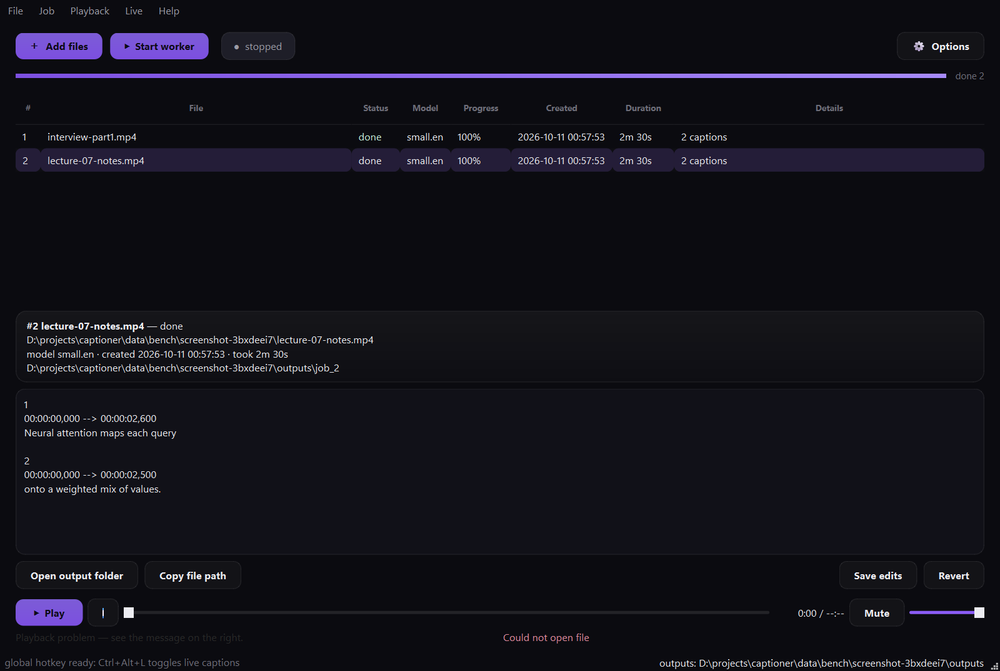

# Captioner

[](https://github.com/shraattt/captioner/actions/workflows/ci.yml)

Local-first AI captioning for Windows. Drop in a lecture, interview or TV
recording and get `SRT`/`VTT` subtitles out; or talk at your laptop and watch a
floating caption bar transcribe you live over any app. Everything runs on your
own machine — no accounts, no servers, no cloud, and your audio never leaves the
computer.

Built and measured around a 6 GB-VRAM laptop GPU (RTX 4050), with a CPU fallback
for everything except the fine-tuning scripts. The recognition and translation
backends are swappable, the queue has a local HTTP API and a browser UI, and a
folder can be watched so files caption themselves.



## What it does

| | |
| --- | --- |
| **Batch subtitles** | Drag media in, get `captions.srt` + `captions.vtt` with word-level timing and caption blocks that break at pauses and sentence ends. |
| **Live captions** | A draggable always-on-top bar that captions your microphone *or* the system audio (what the speakers are playing) in ~1–2 s. `Ctrl+Alt+L` toggles it from any app. |
| **Speaker labels** | Optional pyannote diarization writes `[SPEAKER_00]: …`; caption blocks never mix two speakers. |
| **Word alignment** | Optional wav2vec2 CTC forced alignment re-times every word for sharper subtitle in/out points (WhisperX's idea, no whisperx dependency). |
| **Translation** | Optional M2M100 translation writes `captions.hi.srt` / `.vtt` next to the originals, same timings, cached per line. |
| **Edit in the app** | Fix a caption in the preview pane, save, and the SRT/VTT/database rows are rewritten atomically. |
| **Fine-tuned models** | Fine-tune Whisper on noisy audio yourself; converted models appear in the model picker automatically. |
| **Live translation** | Translate live captions as they appear, into any of 27 languages — on their own thread, cached per sentence, so the captions never wait. |
| **Pluggable engines** | Point the recognizer or the translator at an OpenAI-compatible API (OpenAI, Groq, LM Studio, faster-whisper-server) with two environment variables; the local models stay the default. |
| **HTTP API + browser UI** | A JSON API with an OpenAPI description (`/openapi.json`) plus a browser page, so scripts or another machine can drive the queue. |
| **Watch folders + webhooks** | Caption everything dropped into a folder unattended, then POST each finished job to a URL. |
| **Honest queue** | A real worker/queue with cancel, progress, heartbeats and crash recovery — a power cut cannot wedge it. |

Measured on 100 held-out noisy clips (synthetic noise over LibriSpeech, RTX 4050
6 GB) — the fine-tune is real, not aspirational:

| model | WER | realtime factor |
| --- | --- | --- |
| `tiny.en` (live default) | 21.8% | 21.7× |
| `base.en` (off-the-shelf) | 17.6% | 19.1× |
| `small.en` | 16.3% | 13.9× |
| fine-tuned `base_en_noisy` (HF) | **10.4%** | 24.9× |
| fine-tuned `base_en_noisy` (CTranslate2 fp16) | **12.8%** | 44.3× |

## Contents

- [Requirements](#requirements)
- [Install](#install)
- [First five minutes](#first-five-minutes)
- [Running the app](#running-the-app)
  - [Dashboard](#dashboard) · [Keyboard shortcuts](#keyboard-shortcuts) · [Editing captions](#editing-captions) · [Live captions](#live-captions) · [Command line](#command-line)
- [Optional features](#optional-features)
  - [Speaker labels](#speaker-labels-diarization) · [Word alignment](#word-alignment) · [Translation](#translation)
  - [Pluggable engines](#pluggable-engines) · [HTTP API and browser UI](#http-api-and-browser-ui) · [Watch folders and webhooks](#watch-folders-and-webhooks)
- [How it works](#how-it-works)
- [Fine-tuning your own model](#fine-tuning-your-own-model)
- [Configuration](#configuration)
- [Where your files live](#where-your-files-live)
- [Troubleshooting](#troubleshooting)
- [Benchmarks](#benchmarks)
- [Tests](#tests)
- [Project layout](#project-layout)
- [Roadmap](#roadmap)
- [Design trade-offs and known limitations](#design-trade-offs-and-known-limitations)
- [Privacy](#privacy)

## Requirements

- **Windows 10/11.** The launchers, the overlay and the global hotkey are
  Windows-specific (the core library is portable Python).
- **Python 3.11 – 3.13** (developed on 3.13). Install from
  [python.org](https://www.python.org/downloads/) and tick *"Add python.exe to
  PATH"*.
- **An NVIDIA GPU is optional but recommended.** With one, install PyTorch's
  CUDA 12.8 wheels (step 2 below) and Whisper runs 10–20× faster than real time.
  Without one everything still works on CPU, just slowly.
- **Disk:** ~100 MB for the app, ~1.5 GB of model weights (more if you pick
  bigger models), ~2 GB extra if you fine-tune.
- **No system ffmpeg needed** — audio and video are decoded by the bundled
  PyAV/ffmpeg libraries inside `faster-whisper`.

## Install

### 1. Get the code

```powershell
git clone https://github.com/<your-account>/captioner.git
cd captioner
```

### 2. Install (one command)

```powershell
.\run_captioner.bat
```

On the first run this creates `.venv`, installs PyTorch (CUDA build), installs
`requirements.txt`, checks the GPU stack, and launches the app. Later runs start
straight into the dashboard. If you prefer to see every step, do it by hand:

```powershell
python -m venv .venv
.venv\Scripts\activate

# PyTorch CUDA runtime first — the install order matters, because the CUDA
# wheels come from a different index:
pip install torch --index-url https://download.pytorch.org/whl/cu128

pip install -r requirements.txt

# Verify the stack (add --model tiny.en to run a real inference):
python scripts\check_env.py
```

> **CPU-only machine?** Skip the PyTorch line above and just install
> `requirements.txt`; the app auto-selects `cpu` and `int8`.

### 3. Hugging Face token (only for speaker labels)

The pyannote speaker models are gated. Once, while logged in at
[huggingface.co](https://huggingface.co):

1. Click **agree** on both pages:
   [speaker-diarization-3.1](https://huggingface.co/pyannote/speaker-diarization-3.1)
   and [segmentation-3.0](https://huggingface.co/pyannote/segmentation-3.0).
2. Create a **Read** token (Settings → Access Tokens).
3. `copy .env.example .env` and paste the token in — `.env` is gitignored.
4. Verify: `python scripts\verify_hf_access.py`

Nothing else needs a token: transcription, alignment, translation and the
fine-tuning scripts download public models anonymously (a token in `.env` is
used for faster downloads when present).

### 4. Desktop shortcut (optional)

```powershell
".venv\Scripts\python" scripts\make_shortcut.py    # or "Create Desktop shortcut.bat"
```

The shortcut points at `Captioner.vbs`, which starts the dashboard **silently**
(no console window). First launch falls back to the visible `.bat` once, because
the initial setup needs to show download progress.

## First five minutes

1. Double-click the **Captioner** shortcut (or run `run_captioner.bat`).
2. Drag an `mp4`/`wav`/`mp3` onto the window, or press `Ctrl+O`.
3. Press **Start worker**. The job shows `downloading model 42%` on the very
   first run, then `transcribing 87%`.
4. Select the finished row: the captions appear below and you can listen to the
   audio while reading them (the transport plays audio only, so video files are
   just sound).
5. Output lands in `data\outputs\job_<id>\captions.srt` and `.vtt`
   (`Ctrl+E` opens the folder).

## Running the app

### Dashboard

```powershell
.venv\Scripts\python -m ui.dashboard      # or run_dashboard.bat
```

The window has a calm header (Add files / Start worker / worker status pill /
Options), a borderless job list with status pills, a details card for the
selected job, the caption editor, and a slim player docked at the bottom.

- **Options** (top right) holds everything secondary: model choice, *Identify
  speakers*, *Align word timings*, *Translate captions*, watch-folder and
  notifications.
- **Right-click a row** for per-job actions: cancel, retry, remove, open output
  folder, copy path.
- **Tools → Toggle web API + UI** serves the queue over HTTP (loopback by
  default) and prints the URL in the status bar; `python cli.py api` serves the
  same thing standalone.
- Everything applies to **newly queued files**; a job keeps the options it was
  created with, even if you change the checkboxes later.

### Keyboard shortcuts

| Shortcut | Action |
| --- | --- |
| `Ctrl+O` / `Ctrl+Shift+O` | Add files / add every media file in a folder |
| `Ctrl+R` | Retry the selected job |
| `Delete` | Remove the selected job (outputs stay on disk) |
| `Ctrl+S` / `Ctrl+Shift+Z` | Save / discard caption edits |
| `Ctrl+E`, `Ctrl+Shift+C` | Open the output folder, copy the file path |
| `Space` | Play / pause the selected job's audio |
| `Ctrl+.` | Stop and rewind |
| `Ctrl+←` / `Ctrl+→` | Back / forward 5 seconds |
| `Ctrl+M` | Mute |
| `Ctrl+Alt+L` | Toggle live captions from **any** application (global hotkey) |
| `Ctrl+Alt+Y` | Same toggle, but only while the dashboard has focus |
| `Ctrl+Q` | Quit |

### Editing captions

Select a finished job and edit any line in the preview pane. The row is marked
`● unsaved edits`; **Save** validates every block and then rewrites
`captions.srt`, `captions.vtt` and the database rows **in one transaction**,
re-exporting through a temp file + swap so a crash mid-save cannot leave a
half-written SRT. **Revert** re-renders from the stored rows. Drafts survive
switching between jobs, and closing the window with unsaved edits asks first.

### Live captions

**Live → Start live captions…** asks which audio source to caption — any
microphone or any output device's *loopback* (i.e. "what the TV is playing").
A floating bar appears with a level meter; drag it anywhere, or right-click it:

- **Caption appearance…** — opacity, text size, bar width, position lock.
- **Show transcript window** — the whole session so far, scrollable.
- Hovering the bar reveals **stop**; `Ctrl+Alt+L` toggles from any app.

**Live → Live translation** picks a language for the *live* captions: finished
sentences are translated off the audio thread and shown under the captions (and
in the transcript window, as a bilingual read-back). The same menu turns it off.
The first sentence in a new language loads that model — one pause — and
every sentence after it is cached.

`tiny.en` is the default live model because it measured most accurate on clear
audio; `base.en`/`small.en` trade latency for robustness on noisy sources, and
any [fine-tuned model](#fine-tuning-your-own-model) you convert shows up in the
same list.

### Command line

Everything the dashboard does is scriptable:

```powershell
.venv\Scripts\python cli.py add lecture.mp4 --diarize --align --translate-to hi
.venv\Scripts\python cli.py status                 # list the queue
.venv\Scripts\python cli.py run-once               # process one job
.venv\Scripts\python cli.py work                   # run the worker loop (run_worker.bat)
.venv\Scripts\python cli.py retry 12               # requeue a job
.venv\Scripts\python cli.py translate 12 --to ta   # add subtitles in another language
.venv\Scripts\python cli.py languages              # list translation targets
.venv\Scripts\python cli.py watch --dir D:\Shows   # caption a folder unattended
.venv\Scripts\python cli.py api --open             # serve the HTTP API + browser UI
```

| Command | Options |
| --- | --- |
| `add <file>` | `--diarize`, `--align`, `--translate-to LANG` |
| `status` | — |
| `run-once` / `work` | — |
| `retry <job_id>` | — |
| `translate <job_id>` | `--to LANG` (required), `--model HF_REPO_OR_DIR` |
| `languages` | — |
| `watch` | `--dir PATH` (repeatable), `--interval SECONDS`, `--diarize`, `--align`, `--translate-to LANG` |
| `api` | `--host`, `--port`, `--token`, `--open` |

**Long runs, cancels and crashes.** Progress is real: `downloading model 42%`,
`loading model`, `transcribing 87%`. A running job can be canceled and settles as
`canceled`. Running jobs heartbeat into SQLite every second; on startup the
dashboard requeues any `running` job whose heartbeat is older than 2 minutes, so
a hard kill or power loss cannot wedge the queue.

## Optional features

### Speaker labels (diarization)

Tick **Identify speakers** in **Options** before adding files (or `--diarize`):
the worker adds a pyannote pass and writes `[SPEAKER_00]: …` prefixes into the
SRT/VTT and the editable preview. Needs the
[Hugging Face token](#3-hugging-face-token-only-for-speaker-labels). Speaker
turns are read through the same decoder transcription uses, which sidesteps
pyannote 4's torchcodec dependency.

### Word alignment

Whisper's word timestamps come from cross-attention heuristics, so a word often
inherits the silence in front of it. Tick **Align word timings (wav2vec2)**
(or `--align`) and the worker keeps Whisper's *transcript* but re-times every
word against `facebook/wav2vec2-base-960h` using a numpy Viterbi CTC forced
alignment over 20 ms frames — ~10× more precise, and it runs *before*
segmentation so caption blocks are built from the tightened timings.

It is deliberately conservative, so turning it on cannot make timings worse:

- a span that is implausible (>4× the word's Whisper duration) or that drifts
  more than 0.6 s from Whisper's estimate keeps Whisper's timing;
- overlaps are clamped so blocks never cross;
- if the model cannot be loaded (or the download fails) the pass is skipped and
  the job still finishes.

First use downloads ~380 MB.

### Translation

Pick a language under **Translate captions** (or `--translate-to hi`) and the job
also writes `captions.<lang>.srt`/`.vtt` beside the originals — same timings,
same speaker labels, speaker tags never translated. Because it reads
`captions.srt`, a finished job can be translated later without re-transcribing:

```powershell
.venv\Scripts\python cli.py translate 12 --to hi       # Hindi
.venv\Scripts\python cli.py translate 12 --to ta --model facebook/m2m100_1.2B
```

- **Model:** `facebook/m2m100_418M` (~1.8 GB, loaded lazily on first use,
  fp16 on GPU). The original plan was NLLB, but **transformers 5 removed NLLB's
  text model** (and its task pipelines); M2M100 is the multilingual
  encoder-decoder NLLB was built on. One constant
  (`captioner/translate.py::MODEL_NAME`) switches back if NLLB returns.
- **Cache:** every line is cached in `data/cache/translations.json` keyed by
  language + text (+ model), so re-runs and repeated phrases are free — a cached
  job translates in ~0.5 s versus ~30 s cold. Overriding the model re-translates
  instead of reading the old lines.
- **Languages:** a 27-language shortlist from M2M100's 100 codes
  (`python cli.py languages`). M2M100 has no Telugu, so `te` is deliberately
  absent rather than silently broken.
- **Quality:** uneven by language at 418M — Hindi reads clean, Tamil is weaker
  on longer lines. Decoding is beam-4 with an n-gram repetition block, because
  greedy decoding looped on short subtitle lines. Try
  `--model facebook/m2m100_1.2B` when a language reads badly.
- A failed translation **never** discards a finished transcript: the warning
  shows in the job's error column and the captions stay put.

### Pluggable engines

Recognition and translation both go through a registry (`captioner/engines/`):
a backend is a name plus a small interface, and the pipeline, the UI and the CLI
never import one directly. Selection is an environment variable, so swapping a
model never means touching code.

| Kind | Name | What it is |
| --- | --- | --- |
| asr | `faster-whisper` | local CTranslate2 models, GPU or CPU (the default) |
| asr | `openai` | `POST /audio/transcriptions` — OpenAI, or any compatible server |
| mt | `m2m100` | local M2M100 through transformers (the default) |
| mt | `openai` | `POST /chat/completions` — OpenAI, Groq, OpenRouter, LM Studio, vLLM |

```powershell
set CAPTIONER_ASR_ENGINE=openai
set OPENAI_API_KEY=sk-...
set CAPTIONER_ASR_MODEL=whisper-1
# a local OpenAI-compatible server works the same way:
set CAPTIONER_API_BASE_URL=http://127.0.0.1:8000/v1
.venv\Scripts\python cli.py add lecture.mp4
```

`GET /api/engines` (and `captioner.engines.probe`) reports every registered
backend, whether the selected one is usable right now, and why not. The API
backends take an injectable HTTP transport, so the test suite exercises their
request/response handling without a network.

### HTTP API and browser UI

```powershell
.venv\Scripts\python cli.py api --open      # http://127.0.0.1:8765/
```

Built on the standard library — no web framework, no extra dependency, in
keeping with "the machine that can run this can serve this".

| Route | What it does |
| --- | --- |
| `GET /api/health` | version, queue counts, selected engines, watched folders |
| `GET /api/engines` | every backend, its description and its availability |
| `GET /api/models` · `GET /api/languages` | the pickers' options |
| `GET /api/jobs` · `POST /api/jobs` | list the queue (newest first) / queue a file |
| `GET /api/jobs/{id}` · `DELETE /api/jobs/{id}` | one job with its caption blocks / remove it |
| `GET /api/jobs/{id}/captions?format=json` | the captions as rows (`srt`, `vtt`, `text` too) |
| `POST /api/jobs/{id}/retry` · `POST /api/jobs/{id}/translate` | requeue, or write `captions.<lang>.srt` |
| `GET /` · `GET /openapi.json` | the browser UI, and an OpenAPI 3.0 description of all of it |

```powershell
# queue a file and read back its captions, with no UI at all
curl -X POST http://127.0.0.1:8765/api/jobs -H "Content-Type: application/json" ^
     -d "{\"path\": \"D:\\Shows\\talk.mp4\", \"align\": true}"
curl http://127.0.0.1:8765/api/jobs/1/captions?format=srt
```

**Security.** The server binds `127.0.0.1` unless `CAPTIONER_API_HOST` says
otherwise, and it refuses to start on a non-loopback address without a token,
because this API queues local files and returns their transcripts. With
`CAPTIONER_API_TOKEN` set, every request needs `Authorization: Bearer <token>`
(or `?token=`); mutating requests from another origin are rejected; the static
UI is confined to `ui/web/`.

### Watch folders and webhooks

**Options → Watch uploads folder** in the dashboard, or `cli.py watch`, queues
anything that appears in `data/uploads`; `CAPTIONER_WATCH_DIRS` adds more
folders. The scan is idempotent (a path already in the queue is never queued
twice) and a file written to within the last two seconds is left for the next
tick, so a half-finished download is never captioned.

Set `CAPTIONER_WEBHOOK_URL` and every job that settles POSTs one JSON body:

```json
{
  "event": "job.done",
  "sent_at": "2026-10-11T09:41:02",
  "job": {
    "id": 12, "file_name": "lecture.mp4", "status": "done",
    "captions": 214, "duration_ms": 3721000,
    "outputs": ["captions.hi.srt", "captions.srt", "captions.vtt"],
    "options": {"diarize": false, "align": true, "translate_to": "hi"}
  }
}
```

The webhook is best-effort by design: a timeout, a 500 or a dead endpoint is
logged and returns `False` — it never changes a job's outcome and never takes
the worker down. `CAPTIONER_WEBHOOK_SECRET` adds an `X-Captioner-Secret` header
so the receiver can tell a real delivery from a stranger.

## How it works

```
media file ──drop──▶ SQLite jobs queue ──claim──▶ worker (separate process)
                    (the "Redis+Celery            │
                     pattern, in miniature")      ├─ faster-whisper  → word timestamps
                                                  ├─ optional: wav2vec2 alignment re-times words
                                                  ├─ optional: pyannote diarization → speakers
                                                  ├─ caption segmenter (greedy, hard caps)
                                                  ├─ optional: M2M100 translation of the captions
                                                  └─ SRT / VTT writers (atomic)
                                                        │
                       dashboard (PySide6) ◀──reads── data/captioner.db + data/outputs/
```

**The queue is a SQLite table.** Workers claim jobs with a guarded
`queued→running` transaction, so several workers can run without ever taking the
same job — the same shape as Celery+Redis, with zero setup. The worker is a
separate process, so a model or decoder crash cannot take the UI down. Progress
and a heartbeat are written per job; staleness is what distinguishes a slow job
from a dead one.

**A job's pipeline** runs in this order:

1. `ensure_model_downloaded` — pre-fetch weights with byte progress if the model
   is not cached yet (faster-whisper would otherwise download silently inside
   its constructor).
2. `transcribe_words` — faster-whisper with `word_timestamps=True`, a VAD pass,
   and `condition_on_previous_text=False` (carrying context makes Whisper repeat
   itself on repetitive audio).
3. *(optional)* `align.realign_file` — CTC forced alignment tightens word times.
4. *(optional)* `diarize.speaker_blocks` — pyannote turns are merged into the
   words, and blocks are split so they never mix speakers.
5. `segment_words` — group words into caption blocks (see below).
6. Store caption rows, write `captions.srt` + `captions.vtt`.
7. *(optional)* `translate.translate_subtitles` — write `captions.<lang>.*`.

**Segmentation** is a constrained greedy grouping of word timings. Before
appending a word it closes the block if the text would exceed 84 characters or
the block would exceed 5 seconds (hard caps, checked *before* the append so
blocks never overflow); after appending it closes at sentence punctuation when
the block is at least 12 characters, and a pause of ≥0.8 s always breaks. A
single word longer than a cap still gets its own block — words are never split.

**Live captioning** captures on its own thread (SoundCard/WASAPI) into a 16 kHz
ring buffer. A decode timer re-transcribes the last 12 s every 1.5 s (3 s while
silent) with the small live model; words whose start falls before the committed
frontier freeze, so settled text stops flickering. A noise-floor calibration in
the first ~2 s of a session sets the silence gate, and low-confidence segments
are dropped — 40 s of continuous fan noise yields zero hallucinated words.

**Model registry.** `captioner/models.py` is the single place that turns a
picker label into something faster-whisper can load: built-in sizes map to their
Systran repos, and any `data/ft/*_ct2` directory with a `model.bin` is offered
as its own model (with base checkpoint, training size and measured WER read from
the `ft_meta.json` the converter copies in). Local paths and explicit repo ids
work everywhere a size name does.

## Fine-tuning your own model

Whisper's `tiny.en`/`base.en` are trained on clean read speech, so noisy or
distant audio (TV loopback, room mic) hurts them most. Four scripts fix that for
*your* audio profile:

```powershell
# 1. Data: 4 h of LibriSpeech + synthetic noise (SNR, background, gain, dropouts).
#    Streams a few hundred MB instead of the 6 GB split.
#    Refuses to overwrite an existing split unless you add --force.
.venv\Scripts\python scripts\ft_build_dataset.py --hours 4 --eval-hours 0.5 --noise snr,background,gain,dropout

# 2. Fine-tune. bf16 + gradient accumulation + gradient checkpointing fit 6 GB.
.venv\Scripts\python scripts\ft_train.py --model openai/whisper-base.en --epochs 3 --output data\ft\base_en_noisy

# 3. Measure before/after on the held-out noisy split (WER + realtime factor).
.venv\Scripts\python scripts\ft_eval.py --checkpoints tiny.en base.en data\ft\base_en_noisy --limit 100

# 4. Convert for live use and smoke-test it through the real transcription path.
.venv\Scripts\python scripts\ft_convert.py --src data\ft\base_en_noisy --dst data\ft\base_en_noisy_ct2 --bench your_audio.wav
```

Useful flags: `ft_build_dataset.py --musan-path <dir>` for real MUSAN noise,
`--only train|eval` to build one split in a fresh process (see
[Troubleshooting](#troubleshooting)), `ft_train.py --freeze-encoder` to save
VRAM, `--max-steps 30` for a minutes-long smoke run, `ft_eval.py --device cpu`
if you want to compare without the GPU.

**Measured** (100 held-out noisy clips, RTX 4050 6 GB, bf16/fp16): table at the
top of this README. Fine-tuning bought **+9.0 WER points over `tiny.en`** and
**+4.8 over plain `base.en`**, and the CTranslate2 build is 2× faster than the
checkpoint it came from while costing ~2.4 points. Three epochs over 4.25 h took
**5.6 minutes** (~1.2 s/step at batch 8 + accumulation 2), so a weekend is not
required for `base.en`.

**The only number that decides whether this was worth it is on your own audio:**

```powershell
.venv\Scripts\python scripts\wer_check.py my_lecture.wav my_reference.txt --live --live-model base_en_noisy
```

Compare it against `--live-model tiny.en` on the same file. Everything above is
synthetic noise over read speech; real distant-mic audio will be worse.

## Configuration

Knobs live in `captioner/config.py`:

| Setting | Default | Meaning |
| --- | --- | --- |
| `BATCH_MODEL_SIZE` | `distil-large-v3` | Model for queued files (medium's accuracy at ~2.4× its speed). |
| `LIVE_MODEL_SIZE` | `tiny.en` | Live caption model. |
| `DEVICE` | `auto` | `auto`/`cuda`/`cpu`. |
| `COMPUTE_TYPE` | `auto` | `auto` → float16 on GPU, int8 on CPU. |
| `SEGMENT_MAX_CHARS` | 84 | Hard cap on caption text (two comfortable lines). |
| `SEGMENT_MAX_SECONDS` | 5.0 | Hard cap on caption duration. |
| `SEGMENT_MAX_GAP` | 0.8 | A silence this long always ends a block. |
| `SEGMENT_MIN_CHARS` | 12 | Don't end a block on punctuation below this length. |
| `WORKER_POLL_SECONDS` | 1.0 | How often a worker looks for queued work. |

Live tuning constants (window, stride, silence gate, commit margin) are at the
top of `captioner/live.py`. Environment variables:

| Variable | Effect |
| --- | --- |
| `HF_TOKEN` (via `.env`) | Higher download limits; required for the gated pyannote models. |
| `CAPTIONER_CUDA_BIN` | Extra directory to look in for `cublas64_12.dll`/`cudnn64_9.dll`. |
| `CAPTIONER_NO_GLOBAL_HOTKEY=1` | Never claim `Ctrl+Alt+L` system-wide (used by the test suite). |
| `CAPTIONER_TRANSLATE_MODEL` | Override the translation model without touching code. |
| `CAPTIONER_ASR_ENGINE` · `CAPTIONER_MT_ENGINE` | Pick a backend (`faster-whisper`/`openai`, `m2m100`/`openai`). |
| `CAPTIONER_API_BASE_URL` · `OPENAI_API_KEY` | Endpoint and key for the API backends (any OpenAI-compatible server). |
| `CAPTIONER_ASR_MODEL` · `CAPTIONER_MT_MODEL` | Model names for those backends (defaults: `whisper-1`, `gpt-4o-mini`). |
| `CAPTIONER_LIVE_TRANSLATE_TO` | Language for live captions without a UI (empty = off). |
| `CAPTIONER_WATCH_DIRS` | Extra folders to watch, separated by `;` (or the platform separator). |
| `CAPTIONER_WEBHOOK_URL` · `CAPTIONER_WEBHOOK_SECRET` | Where settled jobs are POSTed, and the shared secret header. |
| `CAPTIONER_API_HOST` · `CAPTIONER_API_PORT` · `CAPTIONER_API_TOKEN` | HTTP API bind address, port and bearer token. |

## Where your files live

```
data/
├── uploads/              files you drop in for the "watch uploads folder" option
├── outputs/job_<id>/     captions.srt, captions.vtt, captions.<lang>.srt/.vtt
├── captioner.db          the SQLite queue + caption rows (WAL mode)
├── logs/captioner.log    file log + crash reports from the silent launcher
├── bench/                isolated queue used by scripts/bench_1h.py
├── cache/translations.json   translated lines (keyed by language + text)
└── ft/                   fine-tuning datasets, checkpoints and converted models
```

Nothing under `data/` is committed to git. Media is never copied: a job reads
your file wherever it lives, so moving or deleting it later leaves the outputs
(and the caption rows) intact.

## Troubleshooting

| Symptom | Cause and fix |
| --- | --- |
| `cublas64_12.dll is not found or cannot be loaded` | The cuBLAS wheel is missing. `pip install nvidia-cublas-cu12`, or point `CAPTIONER_CUDA_BIN` at a CUDA Toolkit `bin`. `transcribe.py` preloads it for you when present. |
| Every job fails with a PyAV `TypeError` about `metadata_errors` | Your `av` is too new for `faster-whisper`. Keep the pin: `pip install "av<19"` (guarded by `tests/test_compat.py`). |
| "To support decoding audio data, please install 'torchcodec'" | A dataset script hit `datasets`' own audio decoder. torchcodec must stay uninstalled (its Windows DLLs fail to load), and `ft_build_dataset.py` decodes through soundfile instead — update the script, don't install torchcodec. |
| Speaker labels missing / 401 from Hugging Face | The token is absent or the gated pages were not accepted. Redo [step 3](#3-hugging-face-token-only-for-speaker-labels), then `python scripts\verify_hf_access.py`. |
| `Ctrl+Alt+L` does nothing | Another program already owns the combination (the dashboard says so on startup). Use the in-app `Ctrl+Alt+Y`, or close the other program. |
| Live captions invent words | Your source is quieter than the calibration assumed. Check the level meter on the bar; raise the input volume, or lower the silence gate in `captioner/live.py`. |
| Batch and live at the same time slow down / OOM | Both models share 6 GB. `scripts/stress_mixed.py` shows batch slowing ~30% with live staying real-time; pick a smaller batch model if it thrashes. |
| Dataset build dies with `WinError 10038 ... not a socket` | The HF streaming session goes bad after a long pass. Splits that finished are saved — recover with `--only eval` / `--only train` in a fresh process. |
| `ft_build_dataset.py` says a split "already exists" | Deliberate: it will not overwrite hours of data (or the model trained on it). Add `--force` to rebuild. |
| Translation seems to hang the first time | It is downloading ~1.8 GB of model weights. Later runs are instant (model cached, lines cached). |
| A running job is stuck "running" forever | The worker that owned it died. **Job → Recover stuck jobs**, or it is requeued automatically on the next dashboard start (heartbeat older than 2 minutes). |

## Benchmarks

`scripts/bench_1h.py` synthesizes an hour of speech (looping the 13.9 s smoke
fixture), runs the real pipeline in an isolated queue under `data/bench/`, and
reports wall clock, peak RAM and GPU VRAM. It tries to stay honest: the audio is
synthetic, so treat these as floors.

```powershell
.venv\Scripts\python scripts\bench_1h.py --size tiny.en --hours 1.0
```

Measured on the development machine (RTX 4050 6 GB, i5-12450HX, 16 GB RAM):

| model | 1 h audio | wall clock | realtime factor | peak RAM | VRAM delta |
| --- | --- | --- | --- | --- | --- |
| `tiny.en` | 3603 s | 195.6 s | **18.4×** | 3.2 GiB | +356 MiB |
| `medium` | 3603 s | 874.1 s | **4.1×** | 2.7 GiB | +2.97 GiB |

Other measurement scripts: `bench_live_wer.py` (live model choice on clean
audio), `wer_check.py` (WER against *your* reference), `stress_live.py` (40 live
sessions — no leaks), `stress_mixed.py` (batch + live sharing the GPU),
`model_sweep.py` (model comparison).

## Tests

```powershell
.venv\Scripts\python -m pytest
```

325 tests covering segmentation, subtitle writers, the caption editor,
diarization, alignment, translation, the engine registry and both API backends,
the HTTP API (routing, status codes, token auth, cross-origin writes, path
traversal, queueing end to end), the watch scanner and webhook delivery against a
real local HTTP server, live translation, the model registry, the queue/pipeline
integration, the live engine and the overlay. The model layer is mocked, so the
suite needs **no GPU and no downloads** (the one skip is the Windows hotkey
keystroke test, which this session policy blocks). CI runs `ruff check .` on Linux
and the suite on Windows ([.github/workflows/ci.yml](.github/workflows/ci.yml));
`pip install -r requirements-dev.txt` adds the linter locally.

## Project layout

```
captioner/
├── captioner/                  core library
│   ├── config.py               paths, tunables, live-translation default
│   ├── db.py                   SQLite schema + migrations
│   ├── worker.py               queue claim, pipeline, heartbeat, recovery, webhook
│   ├── api.py                  HTTP API + browser UI (stdlib only)
│   ├── automation.py           watch-folder scan + webhook delivery
│   ├── engines/                pluggable backends
│   │   ├── registry.py         register · resolve · create · probe
│   │   ├── local.py            faster-whisper + M2M100 (the defaults)
│   │   └── openai_compat.py    audio/transcriptions + chat/completions
│   ├── transcribe.py           faster-whisper wrapper, model download/loading
│   ├── segmenter.py            word timings → caption blocks
│   ├── srt.py                  SRT/VTT writers + parser
│   ├── align.py                wav2vec2 CTC forced alignment
│   ├── diarize.py              pyannote speaker turns
│   ├── translate.py            M2M100 translation + cache
│   ├── models.py               model registry (sizes + fine-tuned)
│   ├── live.py                 capture, ring buffer, sliding decode, translation
│   ├── editor.py               caption edit drafts
│   └── player.py               audio transport
├── ui/
│   ├── dashboard/              the window, split by concern
│   │   ├── window.py           menus, layout, status bar
│   │   ├── jobs.py             queue actions + the table (JobQueueMixin)
│   │   ├── preview.py          caption preview, playback, edits
│   │   ├── live.py             live session setup + translation language
│   │   ├── worker.py           the in-app worker thread and its controls
│   │   ├── services.py         the web-API toggle
│   │   ├── widgets.py          the playback control strip
│   │   ├── theme.py            palette + stylesheet
│   │   ├── formatting.py       duration/age/stage helpers
│   │   └── constants.py        identity, columns, media filters
│   ├── web/                    the browser UI (index.html, app.js, style.css)
│   ├── overlay.py              live caption bar + transcript window
│   └── hotkey.py               the global Ctrl+Alt+L registration
├── scripts/                    check_env · bench_1h · bench_live_wer · wer_check
│                               model_sweep · stress_live · stress_mixed
│                               ft_build_dataset · ft_train · ft_eval · ft_convert
│                               verify_hf_access · make_shortcut · make_icon
├── tests/                      pytest suite (model layer mocked)
├── .github/workflows/ci.yml    ruff + pytest on every push
├── cli.py                      command-line control (add · status · work · watch · api)
├── run_captioner.bat           one-click setup + launch
├── Captioner.vbs               silent launcher (no console window)
├── run_dashboard.bat           launch the UI, keep errors visible
├── run_worker.bat              run the worker in a console
├── requirements.txt            runtime dependencies (order matters: see the header)
├── requirements-dev.txt        ruff
├── pyproject.toml              metadata + pytest/ruff config
├── CHANGELOG.md · BACKLOG.md   what shipped, what is deferred and why
└── data/                       (created at runtime) see "Where your files live"
```

## Roadmap

- **Phase 1 — batch captioning: shipped.** Queue/worker, word-timestamp
  transcription, segmenter, SRT/VTT, dashboard with editor and transport.
- **Phase 2 — understanding: shipped.** Pyannote diarization, wav2vec2 word
  alignment, cached M2M100 translation, per-job options.
- **Phase 3 — live overlay: shipped.** Mic/loopback capture, sliding-window
  decode with commit-frontier stabilization, always-on-top bar, global hotkey,
  transcript window, appearance controls.
- **Phase 4 — fine-tuning for noisy audio: shipped.** Noisy LibriSpeech,
  Seq2SeqTrainer on 6 GB, measured before/after WER.
- **Phase 5 — CTranslate2 conversion + live swap: shipped.** Converted models
  appear in the picker next to the built-in sizes.
- **Phase 6 — reach: shipped.** Pluggable ASR/MT backends, a local HTTP API with
  a browser UI, unattended watch folders, and outbound webhooks.
- **Phase 7 — packaging and scale:** PyInstaller build, a load test with a
  documented concurrency ceiling, hardening. *Next.*

## Design trade-offs and known limitations

- **Scale is a design argument, not a load-tested fact.** The queue/worker shape
  is real and runnable, but on one laptop you will not be proving 50-worker
  throughput. The SQLite queue is deliberate: zero-config, and it ports 1:1 to
  Postgres/Redis if this ever becomes a service.
- **Fine-tuning numbers are synthetic.** 4 h of noisy LibriSpeech is a proxy for
  your audio, not a measurement of it. The real gate is `wer_check.py` on a
  recording you trust.
- **Quantization costs accuracy.** The CTranslate2 fp16 build is 2× faster but
  ~2.4 WER points worse than the checkpoint it came from (measured).
- **Translation quality is uneven by language** at 418M parameters, and nothing
  validates translation quality automatically — eyeball one output per language.
- **Alignment is intentionally timid** (0.6 s drift guard): on long repetitive
  audio a genuinely shifted word can be skipped to keep Whisper's timing.
- **Live latency is 1–2 s**, by construction (12 s window re-decoded every
  1.5 s). It is not a streaming model.
- **Windows-first.** The overlay, the global hotkey and the launchers are
  Windows-specific; the core library is portable but untested on macOS/Linux.
- **The HTTP API is loopback-first on purpose.** It can queue local files and
  return their transcripts, so a non-loopback bind requires a token and
  cross-origin writes are refused. It has no user accounts: one token, one
  machine's queue.
- **Live translation is a display feature.** The overlay and the transcript
  window show it; a saved `.srt` from a live session is source-language only,
  and the batch path (which writes `captions.<lang>.srt`) is the one with
  subtitle-file translation.
- **The API engines are unverified against live endpoints here.** Their wire
  format, error mapping and response parsing are unit-tested through an
  injected transport, but no test suite can stand in for one real call against
  your provider.

## Privacy

Everything runs locally: no telemetry, no accounts, no uploads. The only network
traffic is downloading model weights from Hugging Face (and, if you use
translation/alignment/diarization, those models' one-time downloads). Your media,
transcripts and databases stay in `data/` on your machine. The one exception is
opt-in: selecting the `openai` **engine** sends that audio to the endpoint you
configured, and selecting a webhook URL sends job metadata to it. Neither
happens unless you set it, and neither is on by default.

## License

No license file is included: all rights reserved. Open an issue if you want a
different arrangement.
