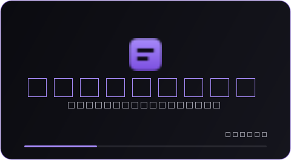

# Captioner

[](https://github.com/shraattt/captioner/actions/workflows/ci.yml)

Local-first AI captioning for Windows. Drop in a lecture, interview or TV
recording and get `SRT`/`VTT` subtitles out; or talk at your laptop and watch a
floating caption bar transcribe you live over any app. Everything runs on your
own machine — no accounts, no servers, no cloud, and your audio never leaves the
computer.

Built and measured around a 6 GB-VRAM laptop GPU (RTX 4050), with a CPU fallback
for everything except the fine-tuning scripts. The recognition and translation
backends are swappable, the queue has a local HTTP API and a browser UI, and a
folder can be watched so files caption themselves.


## What it does

| | |
| --- | --- |
| **Batch subtitles** | Drag media in, get `captions.srt` + `captions.vtt` with word-level timing and caption blocks that break at pauses and sentence ends. |
| **Live captions** | A draggable always-on-top bar that captions your microphone *or* the system audio (what the speakers are playing): a word reaches the screen in ~1–2 s and settles into the transcript ~3 s after that ([both measured](#on-real-audio)). `Ctrl+Alt+L` toggles it from any app. |
| **Speaker labels** | Optional pyannote diarization writes `[SPEAKER_00]: …`; caption blocks never mix two speakers. |
| **Word alignment** | Optional wav2vec2 CTC forced alignment re-times every word for sharper subtitle in/out points (WhisperX's idea, no whisperx dependency). |
| **Translation** | Optional M2M100 translation writes `captions.hi.srt` / `.vtt` next to the originals, same timings, cached per line. |
| **Edit in the app** | Fix a caption in the preview pane, save, and the SRT/VTT/database rows are rewritten atomically. |
| **Fine-tuned models** | Fine-tune Whisper on noisy audio yourself; converted models appear in the model picker automatically. |
| **Live translation** | Translate live captions as they appear, into any of 27 languages — on their own thread, cached per sentence, so the captions never wait. |
| **Pluggable engines** | Point the recognizer or the translator at an OpenAI-compatible API (OpenAI, Groq, LM Studio, faster-whisper-server) with two environment variables; the local models stay the default. |
| **HTTP API + browser UI** | A JSON API with an OpenAPI description (`/openapi.json`) plus a browser page, so scripts or another machine can drive the queue. The page is driven by server-sent events rather than polling. |
| **Watch folders + webhooks** | Caption everything dropped into a folder unattended, then POST each finished job to a URL. |
| **Content de-duplication** | A recording copied in under a second name is recognised by content (size plus both ends of the file), so the same audio is never transcribed twice. Delete the job to run it again. |
| **Honest queue** | A real worker/queue with cancel, progress, heartbeats and crash recovery — a power cut cannot wedge it. |

Measured on 100 held-out noisy clips (synthetic noise over LibriSpeech, RTX 4050
6 GB) — the fine-tune is real, not aspirational:

| model | WER | realtime factor |
| --- | --- | --- |
| `tiny.en` | 21.8% | 21.7× |
| `base.en` (off-the-shelf) | 17.6% | 19.1× |
| `small.en` | 16.3% | 13.9× |
| fine-tuned `base_en_noisy` (HF) | **10.4%** | 24.9× |
| fine-tuned `base_en_noisy` (CTranslate2 fp16) | **12.8%** | 44.3× |

## Contents

- [Requirements](#requirements)
- [Install](#install)
- [Install on another laptop (one file)](#install-on-another-laptop-one-file)
- [First five minutes](#first-five-minutes)
- [Running the app](#running-the-app)
  - [Dashboard](#dashboard) · [Keyboard shortcuts](#keyboard-shortcuts) · [Editing captions](#editing-captions) · [Live captions](#live-captions) · [Command line](#command-line)
- [Optional features](#optional-features)
  - [Speaker labels](#speaker-labels-diarization) · [Word alignment](#word-alignment) · [Translation](#translation)
  - [Pluggable engines](#pluggable-engines) · [HTTP API and browser UI](#http-api-and-browser-ui) · [Watch folders and webhooks](#watch-folders-and-webhooks)
- [How it works](#how-it-works)
- [Fine-tuning your own model](#fine-tuning-your-own-model)
- [Configuration](#configuration)
- [Where your files live](#where-your-files-live)
- [Troubleshooting](#troubleshooting)
- [Benchmarks](#benchmarks)
- [Tests](#tests)
- [Project layout](#project-layout)
- [Roadmap](#roadmap)
- [Design trade-offs and known limitations](#design-trade-offs-and-known-limitations)
- [Privacy](#privacy)

## Requirements

- **Windows 10/11.** The launchers, the overlay and the global hotkey are
  Windows-specific (the core library is portable Python).
- **Python 3.11 – 3.13** (developed on 3.13). Install from
  [python.org](https://www.python.org/downloads/) and tick *"Add python.exe to
  PATH"*.
- **An NVIDIA GPU is optional but recommended.** With one, install PyTorch's
  CUDA 12.8 wheels (step 2 below) and Whisper runs 10–20× faster than real time.
  Without one everything still works on CPU, just slowly.
- **Disk:** ~100 MB for the app, ~1.5 GB of model weights (more if you pick
  bigger models), ~2 GB extra if you fine-tune.
- **No system ffmpeg needed** — audio and video are decoded by the bundled
  PyAV/ffmpeg libraries inside `faster-whisper`.

> **Nothing to install first?** Every requirement above is for running from
> source. The [one-file install](#install-on-another-laptop-one-file) carries
> its own Python, PyTorch runtime and Qt: **no Python, no pip, no admin rights,
> no internet** on the machine that receives it.

## Install

### 1. Get the code

```powershell
git clone https://github.com/<your-account>/captioner.git
cd captioner
```

### 2. Install (one command)

```powershell
.\run_captioner.bat
```

On the first run this creates `.venv`, installs PyTorch (CUDA build), installs
`requirements.txt`, checks the GPU stack, and launches the app. Later runs start
straight into the dashboard. If you prefer to see every step, do it by hand:

```powershell
python -m venv .venv
.venv\Scripts\activate

# PyTorch CUDA runtime first — the install order matters, because the CUDA
# wheels come from a different index:
pip install torch --index-url https://download.pytorch.org/whl/cu128

pip install -r requirements.txt

# Verify the stack (add --model tiny.en to run a real inference):
python scripts\check_env.py
```

> **CPU-only machine?** Skip the PyTorch line above and just install
> `requirements.txt`; the app auto-selects `cpu` and `int8`.

### 3. Hugging Face token (only for speaker labels)

The pyannote speaker models are gated. Once, while logged in at
[huggingface.co](https://huggingface.co):

1. Click **agree** on both pages:
   [speaker-diarization-3.1](https://huggingface.co/pyannote/speaker-diarization-3.1)
   and [segmentation-3.0](https://huggingface.co/pyannote/segmentation-3.0).
2. Create a **Read** token (Settings → Access Tokens).
3. `copy .env.example .env` and paste the token in — `.env` is gitignored.
4. Verify: `python scripts\verify_hf_access.py`

Nothing else needs a token: transcription, alignment, translation and the
fine-tuning scripts download public models anonymously (a token in `.env` is
used for faster downloads when present).

### 4. Desktop shortcut (optional)

```powershell
".venv\Scripts\python" scripts\make_shortcut.py    # or "Create Desktop shortcut.bat"
```

The shortcut points at `Captioner.vbs`, which starts the dashboard **silently**
(no console window). First launch falls back to the visible `.bat` once, because
the initial setup needs to show download progress.

## Install on another laptop (one file)

Nothing above is needed on the machine that ends up running the app. One command
freezes Captioner into a folder, then packs that folder into **a single setup
`.exe`** that installs and starts it:

```powershell
.venv\Scripts\python scripts\package.py --installer           # ~1.5 GB
.venv\Scripts\python scripts\package.py --full --installer     # ~3.0 GB (installs 4.8 GiB)
```

The setup window itself says which build it is (*"Slim build, with GPU support
(CUDA included) … local translation, speaker labels and word alignment are not"*),
and reads that from the three-line `version.txt` the build stamps beside the app,
so the description cannot drift from what was actually packed.

Two artifacts land in `dist/`:

| File | What it is |
| --- | --- |
| `Captioner-Setup-0.7.0.exe` | **The file to hand over.** One file: copy it to a USB stick or a network share, double-click it on the other laptop. |
| `Captioner/` | The app itself — `Captioner.exe`, its dependencies in `_internal\`, and `version.txt`. Copy this folder anywhere and run it (a *portable folder* install); the setup above is this folder, zipped into one file. |

What the setup does, in this order, reporting each step on screen (or in
`%LOCALAPPDATA%\Captioner\logs\setup.log` when run `--silent`):

1. copies the app to `%LOCALAPPDATA%\Programs\Captioner` — per-user, so there is
   **no UAC prompt anywhere in this program**;
2. adds a Start Menu entry, a *Captioner data folder* entry, an **Uninstall**
   entry and a Desktop icon (`--no-shortcuts`, `--no-desktop-icon` to skip);
3. writes a **commented `.env`** to `%LOCALAPPDATA%\Captioner` (never
   overwriting an existing one), which is where the Hugging Face token and every
   optional setting in [Configuration](#configuration) can be switched on;
4. creates the data folder — `%LOCALAPPDATA%\Captioner\data` — so the first
   launch never has to guess;
5. offers to start the app. First launch downloads model weights (~1.5 GB
   for the default batch model) into the Hugging Face cache; after that it is
   fully offline. Models are not inside the installer - a full build downloads
   more when its extra features are first used: 360 MB for word alignment
   (wav2vec2-base-960h) and 1.9 GB for translation on this machine (M2M100).
   Measured with an empty cache on a ~3 MB/s connection, a 14 s clip that
   aligned *and* translated took 20 minutes, almost all of it downloading; the
   same job from cache took 31 s.

```powershell
Captioner-Setup-0.7.0.exe                                 # the window
Captioner-Setup-0.7.0.exe --version                       # version + how big it is
Captioner-Setup-0.7.0.exe --silent --target D:\Captioner   # unattended, no shortcuts
Captioner-Setup-0.7.0.exe --portable                       # self-contained copy
Captioner-Setup-0.7.0.exe --uninstall                      # removes the app, keeps your data
Captioner-Setup-0.7.0.exe --uninstall --purge-data         # removes everything
```

**Portable (`--portable`, or the *Portable* box in the window).** Jobs, captions,
settings and the uninstaller stay *inside* the install folder, so a copy on a USB
stick carries its own state and leaves nothing behind on the machine it is
plugged into. It writes one line — `CAPTIONER_DATA_DIR` — into a `.env` beside
`Captioner.exe`, which is also the file the app reads first, so the settings
move with the stick too.

**Slim or full is a real choice, not a detail.** A slim build is batch captions
plus live captions, live translation through an API engine, and everything that
does not need PyTorch:

| | Slim (default) | `--full` |
| --- | --- | --- |
| Batch subtitles, live captions, editing, queue, API, watch folders | yes | yes |
| GPU (CUDA wheels are packed in both; `--no-cuda` drops them) | yes | yes |
| Live translation via an OpenAI-compatible API | yes | yes |
| Translation on your own machine (M2M100) | — | yes |
| Speaker labels, word alignment | — | yes |
| Fine-tuning (`scripts/ft_*`) | — | yes |
| Installer (one file, downloads) | ~1.5 GB | ~3.0 GB |
| Installed folder | 1.3 GiB | 4.8 GiB |

Slim is the default because the file has to travel; the optional features above
are the ones the README itself calls optional. In a build without them the
feature is refused with a message naming the missing piece, not a stack trace.

**Why the full setup is smaller than what it installs.** PyInstaller's one-file
format addresses its contents with 32-bit offsets, so it cannot carry more than
4 GiB: packing the 4.8 GiB full build file by file died at the very end of a
half-hour build with `struct.error: 'I' format requires 0 <= number <=
4294967295`. `scripts/package.py` therefore compresses a payload that big first
(the portable `.zip`, also left in `dist/`) and embeds that single archive; the
setup unpacks it at install time. The cost is time, not size - see the measured
numbers below.

**Why the full build is 0.9 GiB smaller than it was.** torch/lib already ships
cuBLAS, cuBLASLt, cuDNN and nvrtc, and the build *also* packed
`nvidia-cublas-cu12` and `cuda-nvrtc` beside them: the same DLLs twice, 0.9 GiB
installed and 0.5 GiB in the download, which `preload_cuda_dlls` would have
found in either place (it looks in `nvidia/` first, then `torch/lib`). A full
build now leaves the nvidia wheels out when torch has them; a slim build still
packs them, because it has no torch to borrow them from.

Building needs three things on *your* machine, all already in the development
environment: PyInstaller (`pip install -r requirements-dev.txt`), the wheels the
build should pack (a full build needs torch installed), and Windows — a frozen
build runs on the OS it was built on. `--zip` also writes a portable `.zip` of
the folder, `--smoke` starts the built app with `--self-test` to prove it opens,
and `--smoke-setup` installs and uninstalls the built setup into a throwaway
folder under `build/`.

**Measured on the development machine** (RTX 4050 laptop, warm PyInstaller
cache):

| | Slim | Full |
| --- | --- | --- |
| App folder build | 70-76 s | 935 s |
| App folder | 1.3 GiB | 4.8 GiB (5,117,865,752 bytes) |
| Portable `.zip` | - | 3,091,725,066 bytes, ~11 min |
| Setup `.exe` | 245 s, 1,491,505,188 bytes | 58 s, 3,179,586,136 bytes |
| `--version` (unpacks the payload first) | seconds | 17 s warm; 2m08s for the first run |
| Silent install | seconds | under two minutes (1m58s-2m18s) |

The full setup is one 3.0 GiB file that unpacks to 4.8 GiB, and installing is
mostly writing those 4.8 GiB, in about two minutes. The app it installs was then started with
`--self-test` (*"dashboard self-test OK"*), and `--job talk.wav --align
--translate-to fr` on the installed copy wrote `captions.srt`, `captions.vtt`,
`captions.fr.srt` and `captions.fr.vtt` - a real aligned and translated job,
not an import check. The same job was run from the uninstalled `dist\Captioner`
folder: 34.7 s for a 14 s clip, all four files, on the GPU. The `--version`
number has two values because the first run of a freshly written 3.2 GB `.exe`
spends most of it being scanned; once that has happened it is 17 s.

> **Windows SmartScreen will warn** the first time, because the setup is not code
> signed (a certificate costs money and this is a hobby project): click **More
> info → Run anyway**. For a machine you control, `python scripts\package.py`
> alone is enough — copy `dist\Captioner\` and run `Captioner.exe` from it, and
> the "unknown publisher" dialog never appears.

### Run one file without opening the window

An installed build is also usable from a command prompt or a scheduled task:

```powershell
& "$env:LOCALAPPDATA\Programs\Captioner\Captioner.exe" --job lecture.mp3 --align
```

It queues that one file, runs the same pipeline the queue runs, and prints where
the subtitles went - or why the job failed. `--translate-to fr`, `--diarize`,
`--language hi` and `--model small.en` mean what they mean everywhere else.
Exit code `0` is a finished job, `1` a failed one, `2` a mistyped argument; the
run is also logged to `%LOCALAPPDATA%\Captioner\data\logs\captioner.log`. This is
the quickest way to find out whether a build really contains what its name says:
a slim build refuses `--align` with the sentence a job would show, and a full
one aligns.

## First five minutes

1. Double-click the **Captioner** shortcut (or run `run_captioner.bat`).
2. Drag an `mp4`/`wav`/`mp3` onto the window, or press `Ctrl+O`.
3. Press **Start worker**. The job shows `downloading model 42%` on the very
   first run, then `transcribing 87%`.
4. Select the finished row: the captions appear below and you can listen to the
   audio while reading them (the transport plays audio only, so video files are
   just sound).
5. Output lands in `data\outputs\job_<id>\captions.srt` and `.vtt`
   (`Ctrl+E` opens the folder).

## Running the app

### Dashboard

```powershell
.venv\Scripts\python -m ui.dashboard      # or run_dashboard.bat
```



It opens on a title card — **CAPTIONER**, *project by sharat*, a violet sweep
and the version — which covers the moment the window spends reading the queue,
then fades into the dashboard. It is deliberately short (about a second) and
`--no-splash` (or `CAPTIONER_NO_SPLASH=1`) goes straight to the window.

The window has a calm header (Add files / Start worker / worker status pill /
Options), a borderless job list with status pills, a details card for the
selected job, the caption editor, and a slim player docked at the bottom.

- **Options** (top right) holds everything secondary: model choice, spoken
  language, *Translate captions*, *Identify speakers*, *Align word timings*,
  watch-folder and notifications. Everything applies to **newly queued files**;
  a job keeps the options it was created with, even if you change the controls
  later. The options you leave behind are **remembered** for the next launch.
  An option *this build* cannot run — [the slim installer](#install-on-another-laptop-one-file)
  has no PyTorch — is greyed out and says so in its own label, with the missing
  packages, the fix and the fallback in its tooltip; **Help → About** lists what
  the build carries. A job that asks for one anyway (the API and the CLI can)
  fails with a sentence saying what to install, not a traceback.
- **Right-click a row** for per-job actions: cancel, retry, translate, remove,
  open output folder, copy path.
- **View → Appearance and accessibility…** (`Ctrl+,`) picks the theme, the text
  size and quiet mode; see [themes and accessibility](#appearance-and-accessibility).
- **Tools → Toggle web API + UI** serves the queue over HTTP (loopback by
  default) and prints the URL in the status bar; `python cli.py api` serves the
  same thing standalone.

### Keyboard shortcuts

Every shortcut is also listed in **Help → Keyboard shortcuts** (`F1`), which is
where this table comes from: the two are written from the same list.

| Shortcut | Action |
| --- | --- |
| `Ctrl+O` / `Ctrl+Shift+O` | Add files / add every media file in a folder |
| `Ctrl+R` | Retry the selected job |
| `Ctrl+T` | Translate the selected job into another language |
| `Delete` | Remove the selected job (outputs stay on disk) |
| `Ctrl+S` / `Ctrl+Shift+Z` | Save / discard caption edits |
| `Ctrl+E`, `Ctrl+Shift+C` | Open the output folder, copy the file path |
| `Space` | Play / pause the selected job's audio |
| `Ctrl+.` | Stop and rewind |
| `Ctrl+←` / `Ctrl+→` | Back / forward 5 seconds |
| `Ctrl+M` | Mute |
| `Ctrl+Alt+L` | Toggle live captions from **any** application (global hotkey) |
| `Ctrl+Alt+Y` | Same toggle, but only while the dashboard has focus |
| `Ctrl+,` | Appearance and accessibility (theme, text size, quiet mode) |
| `Ctrl+=` / `Ctrl+-` / `Ctrl+0` | Larger / smaller / normal text |
| `Ctrl+Shift+H` | High contrast theme, on or off |
| `Alt+O` | Open the Options popover |
| `Tab` / `Shift+Tab` | Move between controls (the order follows the window) |
| `F1` | The shortcut list |
| `Ctrl+Q` | Quit |

### Appearance and accessibility

**View → Appearance and accessibility…** (`Ctrl+,`) opens the one dialog that
holds display and interruption settings. Changes preview as you make them, and
**Cancel** puts back exactly what was there.

| Setting | What it does |
| --- | --- |
| Theme | **Dark** (the violet-glass default), **Light** for bright rooms, **High contrast** (opaque surfaces, near-white text on black, yellow focus ring) or **Follow Windows**. |
| Text size | 85–160%, scaling every label, menu and button. `Ctrl+=`/`Ctrl+-`/`Ctrl+0` do the same without opening the dialog. |
| Quiet mode | Keeps the status-bar note when the queue drains, drops the beep and the flashing taskbar entry. |
| Start the worker with the window | For an always-on machine: opening the dashboard begins processing. |

Everything else about accessibility is in the window itself: every control has
an accessible name and description (so a screen reader says "Add files" and
"Queue media files for captioning", not "button"), Tab order follows the
window's layout, every focusable control shows a visible focus ring in all three
themes, the status bar reports every long action, and the job table is reachable
and actionable from the keyboard (arrow keys to move, `Ctrl+R`/`Delete`/
`Ctrl+T` to act). Preferences are stored with `QSettings` (the Windows registry)
and apply at startup.

Colour is checked rather than eyeballed: every text colour in every theme meets
WCAG 2.1 (4.5:1 for normal text, 7:1 in high contrast), asserted in the test
suite for the desktop themes and for the served browser stylesheet. Writing that
test found two real problems — the dark theme's faint text was 3.8:1, and button
labels sat at 4.6:1 — both of which are fixed.

### Editing captions

Select a finished job and edit any line in the preview pane. The row is marked
`● unsaved edits`; **Save** validates every block and then rewrites
`captions.srt`, `captions.vtt` and the database rows **in one transaction**,
re-exporting through a temp file + swap so a crash mid-save cannot leave a
half-written SRT. **Revert** re-renders from the stored rows. Drafts survive
switching between jobs, and closing the window with unsaved edits asks first.

### Live captions

**Live → Start live captions…** asks which audio source to caption — any
microphone or any output device's *loopback* (i.e. "what the TV is playing").
A floating bar appears with a level meter; drag it anywhere, or right-click it:

- **Caption appearance…** — opacity, text size, bar width, position lock.
- **Show transcript window** — the whole session so far, scrollable.
- Hovering the bar reveals **stop**; `Ctrl+Alt+L` toggles from any app.

**Live → Live translation** picks a language for the *live* captions: finished
sentences are translated off the audio thread and shown under the captions (and
in the transcript window, as a bilingual read-back). The same menu turns it off.
The first sentence in a new language loads that model — one pause — and
every sentence after it is cached.

`small.en` is the default live model: on two real lecture recordings it halved
the words it disagreed with the batch model on (15% / 14% against 28% / 23% for
`tiny.en`) and still fits the 1.5 s stride. `tiny.en` stays on the list for a
machine that cannot spare the extra ~0.5 s per window, any
[fine-tuned model](#fine-tuning-your-own-model) you convert shows up there too,
and the numbers behind the choice are in [On real audio](#on-real-audio).

### Command line

Everything the dashboard does is scriptable:

```powershell
.venv\Scripts\python cli.py add lecture.mp4 --diarize --align --translate-to hi
.venv\Scripts\python cli.py status                 # list the queue
.venv\Scripts\python cli.py run-once               # process one job
.venv\Scripts\python cli.py work                   # run the worker loop (run_worker.bat)
.venv\Scripts\python cli.py retry 12               # requeue a job
.venv\Scripts\python cli.py translate 12 --to ta   # add subtitles in another language
.venv\Scripts\python cli.py languages              # list translation targets
.venv\Scripts\python cli.py watch --dir D:\Shows   # caption a folder unattended
.venv\Scripts\python cli.py api --open             # serve the HTTP API + browser UI
```

| Command | Options |
| --- | --- |
| `add <file>` | `--diarize`, `--align`, `--translate-to LANG`, `--language CODE` (spoken; default: detect) |
| `status` | — |
| `run-once` / `work` | — |
| `retry <job_id>` | — |
| `translate <job_id>` | `--to LANG` (required), `--source CODE` (default: what the job heard), `--model HF_REPO_OR_DIR` |
| `languages` | — |
| `watch` | `--dir PATH` (repeatable), `--interval SECONDS`, `--diarize`, `--align`, `--translate-to LANG`, `--language CODE` |
| `api` | `--host`, `--port`, `--token`, `--open` |

**Long runs, cancels and crashes.** Progress is real: `downloading model 42%`,
`loading model`, `transcribing 87%`. A running job can be canceled and settles as
`canceled`. Running jobs heartbeat into SQLite every second; on startup the
dashboard requeues any `running` job whose heartbeat is older than 2 minutes, so
a hard kill or power loss cannot wedge the queue.

## Optional features

### Speaker labels (diarization)

Tick **Identify speakers** in **Options** before adding files (or `--diarize`):
the worker adds a pyannote pass and writes `[SPEAKER_00]: …` prefixes into the
SRT/VTT and the editable preview. Needs the
[Hugging Face token](#3-hugging-face-token-only-for-speaker-labels). Speaker
turns are read through the same decoder transcription uses, which sidesteps
pyannote 4's torchcodec dependency.

### Word alignment

Whisper's word timestamps come from cross-attention heuristics, so a word often
inherits the silence in front of it. Tick **Align word timings (wav2vec2)**
(or `--align`) and the worker keeps Whisper's *transcript* but re-times every
word against `facebook/wav2vec2-base-960h` using a numpy Viterbi CTC forced
alignment over 20 ms frames — ~10× more precise, and it runs *before*
segmentation so caption blocks are built from the tightened timings.

It is deliberately conservative, so turning it on cannot make timings worse:

- a span that is implausible (>4× the word's Whisper duration) or that drifts
  more than 0.6 s from Whisper's estimate keeps Whisper's timing;
- overlaps are clamped so blocks never cross;
- if the model cannot be loaded (or the download fails) the pass is skipped and
  the job still finishes.

First use downloads ~380 MB.

### Spoken languages

**Options → Spoken language** (or `--language hi`, `-l hi`) tells the recogniser
what to listen for; left on *Detect automatically* it works it out and records
what it heard. Both matter:

- **Detection is the default because assuming English is worse.** Forcing `en`
  primes an English decoder, so a Hindi lecture comes back in English —
  translation you did not ask for, with no error to show for it. Naming the
  language skips that step and is more accurate for pairs Whisper confuses.
- **The spoken language is what the translator is handed.** Translate a Hindi
  recording into French and the model is told it is reading Hindi, because
  M2M100 cannot detect that for itself.
- **What came back is shown.** The details card and the browser UI read
  `heard: Hindi` beside `spoken: Hindi`, so a wrong guess is something you can
  see and fix rather than something that quietly shapes the captions.
- **100 languages** (`python cli.py languages`), Whisper's full set — including
  the ones M2M100 cannot translate into, such as Telugu, which the CLI and the
  dashboard both say out loud instead of failing halfway.

### Translation

Pick a language under **Translate captions** (or `--translate-to hi`) and the job
also writes `captions.<lang>.srt`/`.vtt` beside the originals — same timings,
same speaker labels, speaker tags never translated. Because it reads
`captions.srt`, a finished job can be translated later without re-transcribing:
**Job → Translate selection…** (`Ctrl+T`) in the dashboard, **translate…** on a
row in the browser UI, or the CLI:

```powershell
.venv\Scripts\python cli.py translate 12 --to hi       # Hindi
.venv\Scripts\python cli.py translate 12 --to ta --model facebook/m2m100_1.2B
.venv\Scripts\python cli.py translate 12 --to fr --source hi   # read as Hindi
```

- **Model:** `facebook/m2m100_418M` (~1.8 GB, loaded lazily on first use,
  fp16 on GPU). The original plan was NLLB, but **transformers 5 removed NLLB's
  text model** (and its task pipelines); M2M100 is the multilingual
  encoder-decoder NLLB was built on. One constant
  (`captioner/translate.py::MODEL_NAME`) switches back if NLLB returns.
- **Cache:** every line is cached in `data/cache/translations.json` keyed by
  language + text (+ model), so re-runs and repeated phrases are free — a cached
  job translates in ~0.5 s versus ~30 s cold. Overriding the model re-translates
  instead of reading the old lines.
- **Languages:** all **100 M2M100 codes**, generated from the model card by
  `scripts/gen_language_tables.py` (`python cli.py languages` prints them and
  names the ones the translator lacks). M2M100 has no Telugu, so `te` is
  deliberately absent rather than silently broken.
- **Source language:** the transcript is tagged with the language it was spoken
  in — what you chose, else what the recogniser heard, else English. On the
  short clean lines we measured, the output happened to be identical whether the
  text was tagged Hindi or assumed English, because M2M100's encoder is
  genuinely multilingual; the tag is still what the model is designed around,
  and it is what keeps the cache from mixing two readings of the same text.
- **Quality:** uneven by language at 418M — Hindi reads clean, Tamil is weaker
  on longer lines. Decoding is beam-4 with an n-gram repetition block, because
  greedy decoding looped on short subtitle lines. Try
  `--model facebook/m2m100_1.2B` when a language reads badly.
- A failed translation **never** discards a finished transcript: the warning
  shows in the job's error column and the captions stay put.

### Pluggable engines

Recognition and translation both go through a registry (`captioner/engines/`):
a backend is a name plus a small interface, and the pipeline, the UI and the CLI
never import one directly. Selection is an environment variable, so swapping a
model never means touching code.

| Kind | Name | What it is |
| --- | --- | --- |
| asr | `faster-whisper` | local CTranslate2 models, GPU or CPU (the default) |
| asr | `openai` | `POST /audio/transcriptions` — OpenAI, or any compatible server |
| mt | `m2m100` | local M2M100 through transformers (the default) |
| mt | `openai` | `POST /chat/completions` — OpenAI, Groq, OpenRouter, LM Studio, vLLM |

```powershell
set CAPTIONER_ASR_ENGINE=openai
set OPENAI_API_KEY=sk-...
set CAPTIONER_ASR_MODEL=whisper-1
# a local OpenAI-compatible server works the same way:
set CAPTIONER_API_BASE_URL=http://127.0.0.1:8000/v1
.venv\Scripts\python cli.py add lecture.mp4
```

`GET /api/engines` (and `captioner.engines.probe`) reports every registered
backend, whether the selected one is usable right now, and why not. The API
backends take an injectable HTTP transport, so the test suite exercises their
request/response handling without a network.

### HTTP API and browser UI

```powershell
.venv\Scripts\python cli.py api --open      # http://127.0.0.1:8765/
```

Built on the standard library — no web framework, no extra dependency, in
keeping with "the machine that can run this can serve this".

| Route | What it does |
| --- | --- |
| `GET /api/health` | version, queue counts, selected engines, watched folders |
| `GET /api/engines` | every backend, its description and its availability |
| `GET /api/models` · `GET /api/languages` | the pickers' options; languages returns `spoken` (100), `translation` (100) and `languages` (the translation set, kept for older clients) |
| `GET /api/jobs` · `POST /api/jobs` | list the queue (newest first) / queue a file (`200` + `duplicate: true` if the content is already handled) |
| `GET /api/jobs/{id}` · `DELETE /api/jobs/{id}` | one job with its caption blocks / remove it |
| `GET /api/jobs/{id}/captions?format=json` | the captions as rows (`srt`, `vtt`, `text` too) |
| `POST /api/jobs/{id}/cancel` | stop a queued job; ask a running one to stop |
| `POST /api/jobs/{id}/retry` · `POST /api/jobs/{id}/translate` | requeue, or write `captions.<lang>.srt` |
| `GET /api/events` | queue changes as server-sent events, so the page never polls |
| `GET /` · `GET /favicon.ico` · `GET /openapi.json` | the browser UI, its icon, and an OpenAPI 3.0 description of all of it |

```powershell
# queue a file and read back its captions, with no UI at all
curl -X POST http://127.0.0.1:8765/api/jobs -H "Content-Type: application/json" ^
     -d "{\"path\": \"D:\\Shows\\talk.mp4\", \"align\": true, \"language\": \"hi\"}"
curl http://127.0.0.1:8765/api/jobs/1/captions?format=srt
```

`POST /api/jobs` takes `path`, `model`, `language` (spoken language, omitted =
detect), `translate_to`, `diarize` and `align`; an unknown language code is a
`400` at queue time rather than a surprise later. Job JSON carries
`source_lang`/`source_lang_name` (what you asked for) and
`detected_lang`/`detected_lang_name` (what the recogniser heard), and
`POST /api/jobs/{id}/translate` reads the transcript as the spoken language
rather than assuming English.

**Security.** The server binds `127.0.0.1` unless `CAPTIONER_API_HOST` says
otherwise, and it refuses to start on a non-loopback address without a token,
because this API queues local files and returns their transcripts. With
`CAPTIONER_API_TOKEN` set, every request needs `Authorization: Bearer <token>`
(or `?token=`); mutating requests from another origin are rejected; the static
UI is confined to `ui/web/`.

### Watch folders and webhooks

**Options → Watch uploads folder** in the dashboard, or `cli.py watch`, queues
anything that appears in `data/uploads`; `CAPTIONER_WATCH_DIRS` adds more
folders. The scan is idempotent (a path already in the queue is never queued
twice) and a file written to within the last two seconds is left for the next
tick, so a half-finished download is never captioned.

Set `CAPTIONER_WEBHOOK_URL` and every job that settles POSTs one JSON body:

```json
{
  "event": "job.done",
  "sent_at": "2026-10-11T09:41:02",
  "job": {
    "id": 12, "file_name": "lecture.mp4", "status": "done",
    "captions": 214, "duration_ms": 3721000,
    "outputs": ["captions.hi.srt", "captions.srt", "captions.vtt"],
    "options": {"diarize": false, "align": true, "translate_to": "hi"}
  }
}
```

The webhook is best-effort by design: a timeout, a 500 or a dead endpoint is
logged and returns `False` — it never changes a job's outcome and never takes
the worker down. `CAPTIONER_WEBHOOK_SECRET` adds an `X-Captioner-Secret` header
so the receiver can tell a real delivery from a stranger.

## How it works

```
media file ──drop──▶ SQLite jobs queue ──claim──▶ worker (separate process)
                    (the "Redis+Celery            │
                     pattern, in miniature")      ├─ faster-whisper  → word timestamps
                                                  ├─ optional: wav2vec2 alignment re-times words
                                                  ├─ optional: pyannote diarization → speakers
                                                  ├─ caption segmenter (greedy, hard caps)
                                                  ├─ optional: M2M100 translation of the captions
                                                  └─ SRT / VTT writers (atomic)
                                                        │
                       dashboard (PySide6) ◀──reads── data/captioner.db + data/outputs/
```

**The queue is a SQLite table.** Workers claim jobs with a guarded
`queued→running` transaction, so several workers can run without ever taking the
same job — the same shape as Celery+Redis, with zero setup. The worker is a
separate process, so a model or decoder crash cannot take the UI down. Progress
and a heartbeat are written per job; staleness is what distinguishes a slow job
from a dead one.

**A job's pipeline** runs in this order:

1. `ensure_model_downloaded` — pre-fetch weights with byte progress if the model
   is not cached yet (faster-whisper would otherwise download silently inside
   its constructor).
2. `transcribe_words` — faster-whisper with `word_timestamps=True`, a VAD pass,
   and `condition_on_previous_text=False` (carrying context makes Whisper repeat
   itself on repetitive audio).
3. *(optional)* `align.realign_file` — CTC forced alignment tightens word times.
4. *(optional)* `diarize.speaker_blocks` — pyannote turns are merged into the
   words, and blocks are split so they never mix speakers.
5. `segment_words` — group words into caption blocks (see below).
6. Store caption rows, write `captions.srt` + `captions.vtt`.
7. *(optional)* `translate.translate_subtitles` — write `captions.<lang>.*`.

**Segmentation** is a constrained greedy grouping of word timings. Before
appending a word it closes the block if the text would exceed 84 characters or
the block would exceed 5 seconds (hard caps, checked *before* the append so
blocks never overflow); after appending it closes at sentence punctuation when
the block is at least 12 characters, and a pause of ≥0.8 s always breaks. A
single word longer than a cap still gets its own block — words are never split.

**Live captioning** captures on its own thread (SoundCard/WASAPI) into a 16 kHz
ring buffer. A decode timer re-transcribes the last 12 s every 1.5 s (3 s while
silent) with the small live model; words whose start falls before the committed
frontier freeze, so settled text stops flickering, and the timer's wait is cut
short the moment the microphone hears the speaker return — a pause costs the
resumed words one decode, not the rest of the idle stride. A noise-floor
calibration in the first ~2 s of a session sets the silence gate, and
low-confidence segments are dropped — 40 s of continuous fan noise yields zero
hallucinated words.

**Model registry.** `captioner/models.py` is the single place that turns a
picker label into something faster-whisper can load: built-in sizes map to their
Systran repos, and any `data/ft/*_ct2` directory with a `model.bin` is offered
as its own model (with base checkpoint, training size and measured WER read from
the `ft_meta.json` the converter copies in). Local paths and explicit repo ids
work everywhere a size name does.

## Fine-tuning your own model

Whisper's `tiny.en`/`base.en` are trained on clean read speech, so noisy or
distant audio (TV loopback, room mic) hurts them most. Four scripts fix that for
*your* audio profile:

```powershell
# 1. Data: 4 h of LibriSpeech + synthetic noise (SNR, background, gain, dropouts).
#    Streams a few hundred MB instead of the 6 GB split.
#    Refuses to overwrite an existing split unless you add --force.
.venv\Scripts\python scripts\ft_build_dataset.py --hours 4 --eval-hours 0.5 --noise snr,background,gain,dropout

# 2. Fine-tune. bf16 + gradient accumulation + gradient checkpointing fit 6 GB.
.venv\Scripts\python scripts\ft_train.py --model openai/whisper-base.en --epochs 3 --output data\ft\base_en_noisy

# 3. Measure before/after on the held-out noisy split (WER + realtime factor).
.venv\Scripts\python scripts\ft_eval.py --checkpoints tiny.en base.en data\ft\base_en_noisy --limit 100

# 4. Convert for live use and smoke-test it through the real transcription path.
.venv\Scripts\python scripts\ft_convert.py --src data\ft\base_en_noisy --dst data\ft\base_en_noisy_ct2 --bench your_audio.wav
```

Useful flags: `ft_build_dataset.py --musan-path <dir>` for real MUSAN noise,
`--only train|eval` to build one split in a fresh process (see
[Troubleshooting](#troubleshooting)), `ft_train.py --freeze-encoder` to save
VRAM, `--max-steps 30` for a minutes-long smoke run, `ft_eval.py --device cpu`
if you want to compare without the GPU.

**Measured** (100 held-out noisy clips, RTX 4050 6 GB, bf16/fp16): table at the
top of this README. Fine-tuning bought **+9.0 WER points over `tiny.en`** and
**+4.8 over plain `base.en`**, and the CTranslate2 build is 2× faster than the
checkpoint it came from while costing ~2.4 points. Three epochs over 4.25 h took
**5.6 minutes** (~1.2 s/step at batch 8 + accumulation 2), so a weekend is not
required for `base.en`.

**The only number that decides whether this was worth it is on your own audio:**

```powershell
.venv\Scripts\python scripts\wer_check.py my_lecture.wav my_reference.txt --live --live-model base_en_noisy
```

Compare it against `--live-model tiny.en` on the same file. Everything above is
synthetic noise over read speech; real distant-mic audio will be worse.

## Configuration

Knobs live in `captioner/config.py`:

| Setting | Default | Meaning |
| --- | --- | --- |
| `BATCH_MODEL_SIZE` | `distil-large-v3` | Model for queued files (medium's accuracy at ~2.4× its speed). |
| `LIVE_MODEL_SIZE` | `small.en` | Live caption model (`tiny.en` for a weaker machine). |
| `DEVICE` | `auto` | `auto`/`cuda`/`cpu`. |
| `COMPUTE_TYPE` | `auto` | `auto` → float16 on GPU, int8 on CPU. |
| `SEGMENT_MAX_CHARS` | 84 | Hard cap on caption text (two comfortable lines). |
| `SEGMENT_MAX_SECONDS` | 5.0 | Hard cap on caption duration. |
| `SEGMENT_MAX_GAP` | 0.8 | A silence this long always ends a block. |
| `SEGMENT_MIN_CHARS` | 12 | Don't end a block on punctuation below this length. |
| `WORKER_POLL_SECONDS` | 1.0 | How often a worker looks for queued work. |

Live tuning constants (window, stride, silence gate, commit margin) are at the
top of `captioner/live.py`. Environment variables:

| Variable | Effect |
| --- | --- |
| `HF_TOKEN` (via `.env`) | Higher download limits; required for the gated pyannote models. |
| `CAPTIONER_DATA_DIR` | Move the data folder (database, outputs, logs, models) anywhere — a second drive, a network share, a USB stick. This is what an install made with `--portable` writes into its `.env`. |
| `CAPTIONER_ENV_FILE` | Read settings from this file instead of the usual candidates (wins over all of them). |
| `CAPTIONER_CUDA_BIN` | Extra directory to look in for `cublas64_12.dll`/`cudnn64_9.dll`. |
| `CAPTIONER_NO_GLOBAL_HOTKEY=1` | Never claim `Ctrl+Alt+L` system-wide (used by the test suite). |
| `CAPTIONER_TRANSLATE_MODEL` | Override the translation model without touching code. |
| `CAPTIONER_ASR_ENGINE` · `CAPTIONER_MT_ENGINE` | Pick a backend (`faster-whisper`/`openai`, `m2m100`/`openai`). |
| `CAPTIONER_API_BASE_URL` · `OPENAI_API_KEY` | Endpoint and key for the API backends (any OpenAI-compatible server). |
| `CAPTIONER_ASR_MODEL` · `CAPTIONER_MT_MODEL` | Model names for those backends (defaults: `whisper-1`, `gpt-4o-mini`). |
| `CAPTIONER_LIVE_TRANSLATE_TO` | Language for live captions without a UI (empty = off). |
| `CAPTIONER_WATCH_DIRS` | Extra folders to watch, separated by `;` (or the platform separator). |
| `CAPTIONER_WEBHOOK_URL` · `CAPTIONER_WEBHOOK_SECRET` | Where settled jobs are POSTed, and the shared secret header. |
| `CAPTIONER_API_HOST` · `CAPTIONER_API_PORT` · `CAPTIONER_API_TOKEN` | HTTP API bind address, port and bearer token. |

## Where your files live

From a source checkout everything is under the project's `data/`. An installed
build keeps the same tree in `%LOCALAPPDATA%\Captioner\data` (and its settings in
`%LOCALAPPDATA%\Captioner\.env`), because a program folder is not a place to
keep a user's work — see `data_home()` in [config.py](captioner/config.py) for
why, and `CAPTIONER_DATA_DIR` to move it. A `--portable` install keeps the whole
tree in its own folder, next to `Captioner.exe`.

```
data/
├── uploads/              files you drop in for the "watch uploads folder" option
├── outputs/job_<id>/     captions.srt, captions.vtt, captions.<lang>.srt/.vtt
├── captioner.db          the SQLite queue + caption rows (WAL mode)
├── logs/captioner.log    file log + crash reports from the silent launcher
├── bench/                isolated queue used by scripts/bench_1h.py
├── cache/translations.json   translated lines (keyed by language + text)
└── ft/                   fine-tuning datasets, checkpoints and converted models
```

Nothing under `data/` is committed to git. Media is never copied: a job reads
your file wherever it lives, so moving or deleting it later leaves the outputs
(and the caption rows) intact.

## Troubleshooting

| Symptom | Cause and fix |
| --- | --- |
| `cublas64_12.dll is not found or cannot be loaded` | The cuBLAS wheel is missing. `pip install nvidia-cublas-cu12`, or point `CAPTIONER_CUDA_BIN` at a CUDA Toolkit `bin`. `transcribe.py` preloads it for you when present. |
| Every job fails with a PyAV `TypeError` about `metadata_errors` | Your `av` is too new for `faster-whisper`. Keep the pin: `pip install "av<19"` (guarded by `tests/test_compat.py`). |
| "To support decoding audio data, please install 'torchcodec'" | A dataset script hit `datasets`' own audio decoder. torchcodec must stay uninstalled (its Windows DLLs fail to load), and `ft_build_dataset.py` decodes through soundfile instead — update the script, don't install torchcodec. |
| Speaker labels missing / 401 from Hugging Face | The token is absent or the gated pages were not accepted. Redo [step 3](#3-hugging-face-token-only-for-speaker-labels), then `python scripts\verify_hf_access.py`. |
| `Ctrl+Alt+L` does nothing | Another program already owns the combination (the dashboard says so on startup). Use the in-app `Ctrl+Alt+Y`, or close the other program. |
| Live captions invent words | Your source is quieter than the calibration assumed. Check the level meter on the bar; raise the input volume, or lower the silence gate in `captioner/live.py`. |
| Batch and live at the same time slow down / OOM | Both models share 6 GB. `scripts/stress_mixed.py` shows batch slowing ~30% with live staying real-time; pick a smaller batch model if it thrashes. |
| Dataset build dies with `WinError 10038 ... not a socket` | The HF streaming session goes bad after a long pass. Splits that finished are saved — recover with `--only eval` / `--only train` in a fresh process. |
| `ft_build_dataset.py` says a split "already exists" | Deliberate: it will not overwrite hours of data (or the model trained on it). Add `--force` to rebuild. |
| The installed app opens nothing, or closes immediately | There is no console in a packaged build, so the failure was written to `%LOCALAPPDATA%\Captioner\logs\captioner.log`, or `captioner-startup.log` if it died before logging started. Both names are what `scripts/app_window.py` exists to produce. |
| Setup says *"this setup carries no application"* | It was built without the app folder: run `python scripts\package.py` (not `--only-installer`) first, then build the setup again. |
| A packaged build falls back to CPU, or says `cublas64_12.dll is not found` | GPU work needs the CUDA wheels: build without `--no-cuda` (they are ~740 MB of the installer), or point `CAPTIONER_CUDA_BIN` at a CUDA Toolkit `bin` folder. `--no-cuda` builds are for machines with no NVIDIA GPU. |
| Windows warns "unrecognized app" / SmartScreen blocks the setup | It is not code signed (see [Install on another laptop](#install-on-another-laptop-one-file)): **More info → Run anyway**, or use the plain folder build instead of the setup. |
| Translation seems to hang the first time | It is downloading ~1.8 GB of model weights. Later runs are instant (model cached, lines cached). |
| A running job is stuck "running" forever | The worker that owned it died. **Job → Recover stuck jobs**, or it is requeued automatically on the next dashboard start (heartbeat older than 2 minutes). |

## Benchmarks

`scripts/bench_1h.py` synthesizes an hour of speech (looping the 13.9 s smoke
fixture), runs the real pipeline in an isolated queue under `data/bench/`, and
reports wall clock, peak RAM and GPU VRAM. It tries to stay honest: the audio is
synthetic, so treat these as floors.

```powershell
.venv\Scripts\python scripts\bench_1h.py --size tiny.en --hours 1.0
```

Measured on the development machine (RTX 4050 6 GB, i5-12450HX, 16 GB RAM):

| model | 1 h audio | wall clock | realtime factor | peak RAM | VRAM delta |
| --- | --- | --- | --- | --- | --- |
| `tiny.en` | 3603 s | 195.6 s | **18.4×** | 3.2 GiB | +356 MiB |
| `medium` | 3603 s | 874.1 s | **4.1×** | 2.7 GiB | +2.97 GiB |

Other measurement scripts: `bench_real_audio.py` (the real-audio numbers
below), `live_resume_audit.py` (what a pause costs the next captions — with and
without that wake, and with the post-resume cadence the README's "On real audio"
measures a change to — repeated per configuration with the pass order rotating
and reported with a spread), `bench_live_wer.py` (live model choice on clean
synthetic audio), `wer_check.py` (WER against *your* reference),
`stress_live.py` (40 live sessions — no leaks), `stress_mixed.py` (batch + live
sharing the GPU), `model_sweep.py` (model comparison).

### On real audio

Synthetic speech flatters every model, so the numbers that decide anything come
from real recordings. `scripts/bench_real_audio.py` replays one through both
pipelines:

```powershell
.venv\Scripts\python scripts\bench_real_audio.py "D:\lectures\merge-sort.mp4" --live-models tiny.en,small.en
```

Both files below are screen recordings of one study session, a student
presenting *merge sort versus quick sort* — continuous English technical speech
with a room-mic character, not the sort of audio a fixture can fake. Same
machine as above.

**Recording 1 — 3 min 59 s**

| | batch `distil-large-v3` | live `tiny.en` | live `small.en` |
| --- | --- | --- | --- |
| wall clock for 239 s of audio | **12.4 s (19.3×)** | 38.7 s | 67.4 s |
| words written | 425 | 469 | 460 |
| decode cost per 12 s window | — | 0.28 s mean / 0.66 s p95 | 0.51 s mean / 1.07 s p95 |
| word lag (audio time) | — | 1.88 s median | 1.20 s median |
| caption age (audio time, steady state) | — | 3.02 s median / 4.58 s p95 | 3.00 s median / 4.31 s p95 |
| worst opening word (audio time) | — | 5.2 s | 4.3 s |
| disagreement with the batch transcript | — | 27.5% words / 12.2% chars | **14.7% words / 6.4% chars** |
| kept up with the 1.5 s stride | — | yes | yes |
| saved live transcript | — | 55 cues, 0 malformed | 53 cues, 0 malformed |

**Recording 2 — 3 min 5 s**, the segment before it. Batch `distil-large-v3`:
10.4 s wall (17.9×), 294 words — 95 words/min against the live models' 100 and
102, where recording 1 had the batch at 107 and live at 116-118. On this
segment the two paths agree on how much was said; on the other they do not:

| | live `tiny.en` | live `small.en` |
| --- | --- | --- |
| words written | 309 | 314 |
| decode cost per 12 s window | 0.38 s mean / 1.00 s p95 | 0.68 s mean / 1.32 s p95 |
| word lag (audio time) | 1.58 s median | 1.08 s median |
| caption age (audio time, steady state) | 2.96 s median / 4.24 s p95 | 2.94 s median / 4.16 s p95 |
| disagreement with the batch transcript | 23.1% words / 8.7% chars | **13.8% words / 5.7% chars** |

What that says, plainly:

- **There are two latencies, and only one of them is what you see.** A word
  reaches the screen **~1.2–1.9 s** after it is spoken (the model wants a little
  of the following audio before it will report a word at all), and it **settles
  into the transcript ~3 s** after that, because the sliding window gets a 3 s
  commit margin to revise a word before it is frozen. The overlay shows the
  unsettled tail immediately and in a different colour, so the eye gets the fast
  number; a saved `.srt` is built from settled words, so the file gets the slow
  one. Earlier versions of this file quoted one number for both, which is why
  they disagreed with each other.
- **The 10.8 s tail was real, and it was not the pause it looked like.** Words
  did not sit in the queue for ten seconds because the speaker paused — they sat
  there because the model kept changing its mind about the same instant of
  audio, and every re-think arrived with a fresh word in a slot that had not
  been frozen yet. One spoken word came back as "a", "signal", "of" and "the"
  over ten seconds, and all four were frozen; the last carried a 10.8 s age and
  the transcript grew a word per re-think (615 words for a 425-word lecture).
  The freeze step now accepts a word only within `FREEZE_BAND_SECONDS` (3 s) of
  the commit margin, so a re-think about audio that is already captioned is
  refused rather than written, and the window a word can arrive in is never
  narrower than the audio that arrived since the last decode, so a slow GPU or a
  long pause cannot turn the rule into lost speech (`live.LiveEngine._freeze`).
  `scripts/live_freeze_audit.py`
  answers the obvious objection — *did it throw speech away?* — by classifying
  every refusal against the words that were captioned: on these recordings each
  one (159/79 and 84/49 for the two models) landed on a second that was already
  captioned or within 3 s of one, and none was speech that went uncaptioned. On
  the same audio the word count fell from 615 to 469 against the batch model's
  425.
- **A pause no longer costs the idle stride — and that is worth less than it
  looks.** The loop backs off to a 3 s stride while nobody is talking
  (`IDLE_STRIDE_SECONDS`) so the GPU rests, and the wait was also a guess that
  there was nothing to transcribe: a speaker returning mid-nap falsified it while
  their first words sat in the ring, so the *wait* could outlive the pause by a
  whole stride. The capture keeps a 50 ms meter (`MicCapture.sound_level`) beside
  the 100 ms one that drives the overlay, and the loop waits on it
  (`ui.overlay.wait_for_sound`), which bounds that sleep at one 50 ms poll.
  Measured with `scripts/live_resume_audit.py`, which replays a recording
  through the *shipping* loop in real time — three passes per configuration,
  which is what shares out a drift that unfolds over the sitting (the per-decode
  cost swung 2× across this run, all of the last round landing in its fast
  window), with the pass order rotating so that no configuration is always the
  one running in another's wake. Recording 1,
  `small.en`, 18 pauses, three repeats each: the loop's own share of the wait
  before the first caption fell **0.16 s on average (median 0.17 s, sd 0.44 s,
  95% CI ±0.20 s across pauses, 12 pauses faster and 6 slower, sign-test
  p=0.24)** — and the audit now prints the floor to read that against: the *same*
  configuration's own mean moved 0.12–0.21 s between its three repeats, so the
  effect is inside the drift, and averaging cannot rescue it. The tail is not the
  rescue it looked like either: an earlier round of single pairs put the average
  at 0.2 s and claimed 0.7–1.9 s off the unluckiest ~5% of pauses, and repeating
  the measurement does not support the tail — of these 18 pauses the three the
  old loop waited longest on came out 0.65 s faster, 0.76 s faster and 0.65 s
  *slower*, and 5 gained ≥0.5 s against 2 that lost ≥0.5 s. The fair summary is a
  small average with no settled sign, because the loop was never what gated a
  post-pause caption: the model will not report a word with 0.1 s of audio
  behind it, so the resumed words land on the next 1.5 s stride whether the loop
  woke early or not, and a control wait that happens to expire just then prints
  just as fast.
- **Decoding a shorter window at the resume does not bring the caption back
  earlier either, and it is off by default because of it.** The idea was that
  the newest words in that window are the only new ones — the rest is a finished
  utterance the captions already hold — so asking the model for the last 4 s
  instead of 12 should let it report those words sooner. Repeated on recording 1
  it moved the loop's own wait **−0.03 s** against the wake alone (4 pauses
  faster, 14 slower, sd 0.30 s, CI ±0.14 s) and the first caption by **−0.04 s**:
  no direction, and both inside the 0.21 s drift — which is what the earlier
  single pairs said less precisely (+0.07, −0.02, +0.22 and −0.10 s). What it
  does do is cost **42% of a full decode** (0.22–0.25 s against 0.54–0.59 s,
  `live_resume_audit.py --window-cost` on both recordings), so it is kept and off
  by default (`LiveEngine(resume_window_seconds=...)`) as the cheap decode the
  post-resume cadence below spends.
- **What actually catches the words after a pause is decoding on a shorter
  cadence, and it is the one change here that measurably pays.** The wake ends the
  idle nap, but the model will not report a word with ~0.1 s of audio behind it,
  so the resumed words are caught by whatever decode comes next — a whole stride
  later at 1.5 s. For the first 2 s of a resumed utterance the loop now comes back
  every 0.5 s instead (`RESUME_STRIDE_SECONDS`, `RESUME_BURST_SECONDS`), reading
  that 4 s window so the extra decodes cost 42% of a full one. It needed the loop
  to *notice* the resume, and the engine's old signal — a window whose tail was
  quiet — misses the common case: the loop waits 3 s between decodes while nobody
  talks, so a short pause can begin *and* end between two of them and never appear
  as a quiet tail at all. The window holds the evidence either way (speech, then a
  pause, then speech again — `live.resume_instant`), so the decode that reads it
  knows somebody has just come back however the loop happened to be scheduled.
  Same recording, same harness, `--passes before,wake,burst --baseline wake`,
  three repeats each: the loop's own wait before the first post-pause caption fell
  **0.40 s against the wake alone (median 0.37 s, 12 of 18 pauses faster, 6 slower;
  6 pauses gained ≥0.5 s against 3 that lost ≥0.5 s)** and the caption itself
  **0.37 s (median 0.30 s, 13 of 18 faster)**, against a 0.20 s repeat-to-repeat
  floor. Every one of the three repeats beat every repeat without it (1.26 / 1.13
  / 1.17 s against 1.71 / 1.50 / 1.57 s), which is a cleaner statement than the
  average — what a pause gains depends on where the loop's grid happened to sit
  when it ended, so a stride boundary makes it partly a coin toss per pause. It
  costs ~2 extra decodes per pause (193 per 4-minute pass against 154) of 0.24 s
  each, and unlike the two knobs above it ships **on**.
- **The fix is not free.** Keeping the first estimate means the model's later,
  sometimes better reading of a word is dropped: timeline coverage fell from
  79.4% to 73.1% on recording 1 as duplicate words stopped papering over gaps,
  and characters agreed 87.8% (it was 77.3%) with the batch transcript while
  words agreed 72.5% (it was 40.5%). Run `--reference` on your own recording if
  you want to see which way that cuts with ground truth.
- **`small.en` is now the live default, on two recordings rather than one.** It
  halves the disagreement with the batch transcript (14.7% / 13.8% of words
  against 27.5% / 23.1% for `tiny.en`) and its decode p95 of 1.07–1.32 s still
  fits the 1.5 s stride. `tiny.en` is the weak link, not the machinery: it
  re-hears the lecture's vocabulary ("suppose we have two sorted **subarrays**"
  came out as "summaries winners sub arrays") and invents words outright
  ("merge sort" as "Mozart", "quick sort" as "Big Sort"). Both recordings come
  from one session on one laptop, so treat the ranking as a direction rather
  than a law — and **Live → Live model** still offers `tiny.en` for a machine
  that cannot spare the extra ~0.5 s a window.
- **Decode cost is not the problem.** A 12 s window through `tiny.en` costs
  0.28 s of GPU against a 1.5 s stride — roughly 5× headroom — and even
  `small.en` uses under half the budget. (`scripts/bench_live_wer.py` still
  covers the synthetic fixtures.)
- **The anti-hallucination work holds up.** No repetition loops at all on these
  recordings (worst repeated 4-gram seen once, longest run of one word: twice),
  against 40 s of fan noise producing zero invented words in the synthetic test.

Those runs also earned their keep by breaking two things, which is why they
exist. Live words arrive in decode order, not time order, so the transcript a
session saved had **59 cues whose end preceded their start** out of 124, plus 10
overlapping their neighbour: the export now sorts the timeline and pulls each
word's end back to the next word's start, both zero above
(`tests/test_live.py::test_transcript_export_orders_words_that_arrived_out_of_order`).
And the replay used to wait for a full 12 s window before its first decode, which
no real session does — it reported an ~11.5 s opening that the app never had.
`live.LiveEngine.stream_file` now decodes from the first stride like the app,
and the opening cost above (5.2 s / 4.3 s) is the real one.

## Tests

```powershell
.venv\Scripts\python -m pytest
```

412 tests covering segmentation, subtitle writers, the caption editor,
diarization, alignment, translation, the language tables and their validation,
the engine registry and both API backends, the HTTP API (routing, status codes,
token auth, cross-origin writes, path traversal, queueing end to end), the watch
scanner and webhook delivery against a real local HTTP server, live translation,
the model registry, the queue/pipeline integration, the live engine, the overlay,
and the preferences/theming layer (themes build, bad settings are coerced,
options are remembered between windows, quiet mode silences the beep, main
controls announce themselves). The model layer is mocked, so the suite needs
**no GPU and no downloads** (the one skip is the Windows hotkey keystroke test,
which this session policy blocks). CI runs `ruff check .` on Linux
and the suite on Windows ([.github/workflows/ci.yml](.github/workflows/ci.yml));
`pip install -r requirements-dev.txt` adds the linter locally.

## Project layout

```
captioner/
├── captioner/                  core library
│   ├── config.py               paths (checkout vs installed), tunables, .env loading
│   ├── db.py                   SQLite schema + migrations
│   ├── worker.py               queue claim, pipeline, heartbeat, recovery, webhook
│   ├── api.py                  HTTP API + browser UI (stdlib only)
│   ├── automation.py           watch-folder scan + webhook delivery
│   ├── engines/                pluggable backends
│   │   ├── registry.py         register · resolve · create · probe
│   │   ├── local.py            faster-whisper + M2M100 (the defaults)
│   │   └── openai_compat.py    audio/transcriptions + chat/completions
│   ├── transcribe.py           faster-whisper wrapper, model download/loading
│   ├── segmenter.py            word timings → caption blocks
│   ├── srt.py                  SRT/VTT writers + parser
│   ├── align.py                wav2vec2 CTC forced alignment
│   ├── diarize.py              pyannote speaker turns
│   ├── languages.py            spoken vs translation sets, validation
│   ├── language_data.py        both tables, generated (see scripts/)
│   ├── translate.py            M2M100 translation + cache
│   ├── models.py               model registry (sizes + fine-tuned)
│   ├── live.py                 capture, ring buffer, sliding decode, translation
│   ├── editor.py               caption edit drafts
│   └── player.py               audio transport
├── ui/
│   ├── dashboard/              the window, split by concern
│   │   ├── window.py           menus, layout, status bar
│   │   ├── jobs.py             queue actions + the table (JobQueueMixin)
│   │   ├── preview.py          caption preview, playback, edits
│   │   ├── live.py             live session setup + translation language
│   │   ├── worker.py           the in-app worker thread and its controls
│   │   ├── services.py         the web-API toggle
│   │   ├── widgets.py          the playback control strip
│   │   ├── theme.py            three palettes + stylesheet builder
│   │   ├── preferences.py      remembered settings + the preferences dialog
│   │   ├── formatting.py       duration/age/stage helpers
│   │   └── constants.py        identity, columns, media filters
│   ├── web/                    the browser UI (index.html, app.js, style.css)
│   ├── overlay.py              live caption bar + transcript window
│   └── hotkey.py               the global Ctrl+Alt+L registration
├── scripts/                    check_env · bench_1h · bench_real_audio · bench_live_wer
│                               wer_check · model_sweep · stress_live · stress_mixed
│                               ft_build_dataset · ft_train · ft_eval · ft_convert
│                               verify_hf_access · make_shortcut · make_icon
│                               gen_language_tables (regenerates language_data.py)
│   ├── package.py              freeze the app + build the single-file setup .exe
│   ├── installer.py            what that setup runs: copy, shortcuts, .env, data
│   └── app_window.py           the frozen entry point (a crash dialog, not a void)
├── tests/                      pytest suite (model layer mocked)
├── .github/workflows/ci.yml    ruff + pytest on every push
├── cli.py                      command-line control (add · status · work · watch · api)
├── run_captioner.bat           one-click setup + launch
├── Captioner.vbs               silent launcher (no console window)
├── run_dashboard.bat           launch the UI, keep errors visible
├── run_worker.bat              run the worker in a console
├── requirements.txt            runtime dependencies (order matters: see the header)
├── requirements-dev.txt        ruff · pillow (icon) · pyinstaller (packaging)
├── pyproject.toml              metadata + pytest/ruff config
├── CHANGELOG.md · BACKLOG.md   what shipped, what is deferred and why
└── data/                       (created at runtime) see "Where your files live"
```

## Roadmap

- **Phase 1 — batch captioning: shipped.** Queue/worker, word-timestamp
  transcription, segmenter, SRT/VTT, dashboard with editor and transport.
- **Phase 2 — understanding: shipped.** Pyannote diarization, wav2vec2 word
  alignment, cached M2M100 translation, per-job options.
- **Phase 3 — live overlay: shipped.** Mic/loopback capture, sliding-window
  decode with commit-frontier stabilization, always-on-top bar, global hotkey,
  transcript window, appearance controls.
- **Phase 4 — fine-tuning for noisy audio: shipped.** Noisy LibriSpeech,
  Seq2SeqTrainer on 6 GB, measured before/after WER.
- **Phase 5 — CTranslate2 conversion + live swap: shipped.** Converted models
  appear in the picker next to the built-in sizes.
- **Phase 6 — reach: shipped.** Pluggable ASR/MT backends, a local HTTP API with
  a browser UI, unattended watch folders, and outbound webhooks.
- **Phase 7 — packaging and scale: the packaging half is shipped.**
  `scripts/package.py` freezes the app and builds the [single-file
  setup](#install-on-another-laptop-one-file) (slim by default; `--full` for the
  PyTorch features), and an installed build keeps its data in the user's profile
  rather than beside its own executable. Still open: a load test with a
  documented concurrency ceiling, code signing, and hardening.

## Design trade-offs and known limitations

- **Scale is a design argument, not a load-tested fact.** The queue/worker shape
  is real and runnable, but on one laptop you will not be proving 50-worker
  throughput. The SQLite queue is deliberate: zero-config, and it ports 1:1 to
  Postgres/Redis if this ever becomes a service.
- **Fine-tuning numbers are synthetic.** 4 h of noisy LibriSpeech is a proxy for
  your audio, not a measurement of it. The real gate is `wer_check.py` on a
  recording you trust.
- **The real-audio numbers are one recording, one laptop.** The 4-minute
  lecture behind the live table is real speech but still a single file, and its
  `tiny.en`/`small.en` gap is a direction to re-measure rather than a constant.
  Repeats of the same run wobble by a couple of percent (CUDA decoding is not
  deterministic), so read the table as one sample of a distribution.
- **Quantization costs accuracy.** The CTranslate2 fp16 build is 2× faster but
  ~2.4 WER points worse than the checkpoint it came from (measured).
- **Translation quality is uneven by language** at 418M parameters, and nothing
  validates translation quality automatically — eyeball one output per language.
- **Alignment is intentionally timid** (0.6 s drift guard): on long repetitive
  audio a genuinely shifted word can be skipped to keep Whisper's timing.
- **Live latency is ~1.2–1.9 s to the screen and ~3 s to the transcript**
  (median, audio time, measured on real speech), plus one decode cost
  (0.28–0.51 s) before either appears on screen. The 3 s is the commit margin
  that lets the sliding window revise a word before it is frozen, so it is the
  price of a stable transcript rather than of the window stop; the unsettled
  tail is on screen — in a different colour — the whole time. The p95 of ~4.3 s
  is what is left of a tail that used to run to 10.8 s (see "On real audio").
  It is not a streaming model.
- **Windows-first.** The overlay, the global hotkey and the launchers are
  Windows-specific; the core library is portable but untested on macOS/Linux.
- **The HTTP API is loopback-first on purpose.** It can queue local files and
  return their transcripts, so a non-loopback bind requires a token and
  cross-origin writes are refused. It has no user accounts: one token, one
  machine's queue.
- **Live translation is a display feature.** The overlay and the transcript
  window show it; a saved `.srt` from a live session is source-language only,
  and the batch path (which writes `captions.<lang>.srt`) is the one with
  subtitle-file translation.
- **The API engines are unverified against live endpoints here.** Their wire
  format, error mapping and response parsing are unit-tested through an
  injected transport, but no test suite can stand in for one real call against
  your provider.

## Privacy

Everything runs locally: no telemetry, no accounts, no uploads. The only network
traffic is downloading model weights from Hugging Face (and, if you use
translation/alignment/diarization, those models' one-time downloads). Your media,
transcripts and databases stay in `data/` on your machine. The one exception is
opt-in: selecting the `openai` **engine** sends that audio to the endpoint you
configured, and selecting a webhook URL sends job metadata to it. Neither
happens unless you set it, and neither is on by default.

## License

MIT — see [LICENSE](LICENSE). Use it, change it, ship it; the dependencies keep
their own licenses (Whisper and the models you download have theirs, and
`pyannote` for diarization is gated behind a Hugging Face token you accept).
